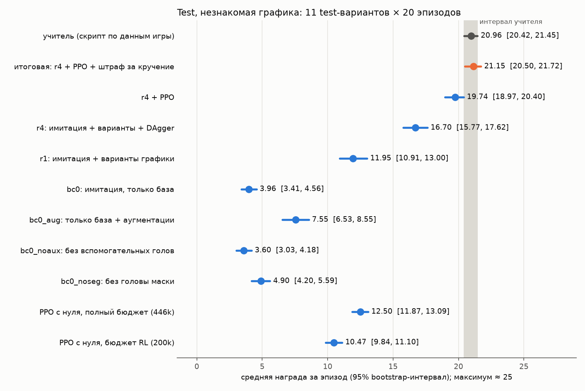

# DoomCNN: агенты для ViZDoom по пикселям

Курсовая работа о том, как научить нейросеть играть в Doom (ViZDoom), видя только экран. Работа состоит из двух
частей. В обеих используется один конвейер:

```
учитель-скрипт с привилегированными данными → имитация (behavior cloning) → варианты графики → DAgger → PPO
```

Каждая часть лежит в своей ветке с подробным README, журналом исследования, отчётами и тестами.

| часть | задача | итог | ветка |
|---|---|---|---|
| **1. defend_the_center** | стоять в центре арены и отстреливать подходящих монстров | **наравне с учителем** и на базовой графике, и на незнакомой | [`doom/defend_the_center`](https://github.com/vladislavsaltanov/DoomCNN/tree/doom/defend_the_center) |
| **2. deathmatch MAP02** | deathmatch против 7 ботов: ходить, собирать оружие, выбирать его, стрелять; сеть с памятью | **88 % фрагов учителя-читера**, на базовой графике наравне с ним | [`doom/deathmatch`](https://github.com/vladislavsaltanov/DoomCNN/tree/doom/deathmatch) |

## Часть 1. defend_the_center

Свёрточная сеть видит 4 последних серых кадра 160×120 и выбирает одно из 5 действий: два размера поворота в каждую
сторону и выстрел. Итог на test (100 эпизодов на базе, 11 test-вариантов графики по 20 эпизодов), средняя награда
за эпизод:

| модель | базовая графика | незнакомая графика |
|---|---|---|
| учитель (скрипт по labels buffer) | 22.89 [22.61, 23.14] | 20.96 [20.42, 21.45] |
| **итоговая** (имитация + варианты + DAgger + PPO со штрафом за кручение) | **22.97** [22.75, 23.19] | **21.15** [20.50, 21.72] |
| только имитация на базовой графике | 23.35 [22.63, 24.02] | 3.96 [3.41, 4.56] |
| PPO с нуля, равный бюджет | 16.66 [16.17, 17.18] | 12.50 [11.87, 13.09] |

Все критерии спецификации выполнены. Главный урок: на незнакомой графике решили варианты графики, DAgger и PPO
(+17 к модели, обученной только на базовой графике).



Подробно: ветка [`doom/defend_the_center`](https://github.com/vladislavsaltanov/DoomCNN/tree/doom/defend_the_center),
журнал [`research_log.md`](research_log.md), отчёт [`reports/s8_final.md`](reports/s8_final.md).

## Часть 2. deathmatch MAP02

Сеть видит 4 серых кадра 320×240 и строку состояния. Каждый шаг она выбирает четыре действия сразу: движение,
поворот на точный угол, выстрел и смену оружия. Память — слой GRU.

Учитель — скрипт-«читер по реакции»: знает карту и места оружия, целится мгновенно, но ботов видит только на экране.

Итог на 60 свежих матчах по 2 минуты:

| модель | фраги за матч | доля учителя | первое место из 8 |
|---|---|---|---|
| учитель | 11.65 [10.58, 12.73] | 100 % | 68 % |
| **итоговая** (DAgger-ученик + PPO 3 млн шагов) | **10.22** [8.88, 11.53] | **88 %** | 68 % |
| имитация + DAgger | 4.83 [3.93, 5.68] | 41 % | 25 % |
| только имитация | 4.53 [3.73, 5.35] | 39 % | 17 % |

- На базовой графике итоговая модель наравне с учителем.
- На незнакомой графике она набирает около половины учителя.
- Имитация упёрлась в 40 %: учитель решает по своей скрытой цели, а её не видно на картинке. Дальше вывел PPO
  со своей рекуррентной реализацией, асимметричным критиком и якорем к стартовой политике.
- Финальная проверка на test ещё впереди.


Подробно: ветка [`doom/deathmatch`](https://github.com/vladislavsaltanov/DoomCNN/tree/doom/deathmatch) — README,
журнал `research_log_dm.md`, отчёты по срезам `reports/dm/` с оглавлением.

## Как открыть ветку

```powershell
git clone https://github.com/vladislavsaltanov/DoomCNN.git
cd DoomCNN
git checkout doom/deathmatch          # или doom/defend_the_center
```

Установка и запуск описаны в README каждой ветки. Для Windows — в [`WINDOWS.md`](WINDOWS.md).

## Ветки

| ветка | что там |
|---|---|
| `main` | этот обзор и код первой части |
| `doom/defend_the_center` | первая часть целиком: код, отчёты, журнал, итоговый README |
| `doom/deathmatch` | вторая часть: код первой части без изменений и deathmatch (`doomagent.dm`), отчёты, журнал |

## Благодарности

[ViZDoom](https://github.com/Farama-Foundation/ViZDoom), [Freedoom](https://freedoom.github.io/),
[Stable-Baselines3](https://github.com/DLR-RM/stable-baselines3), PyTorch.
