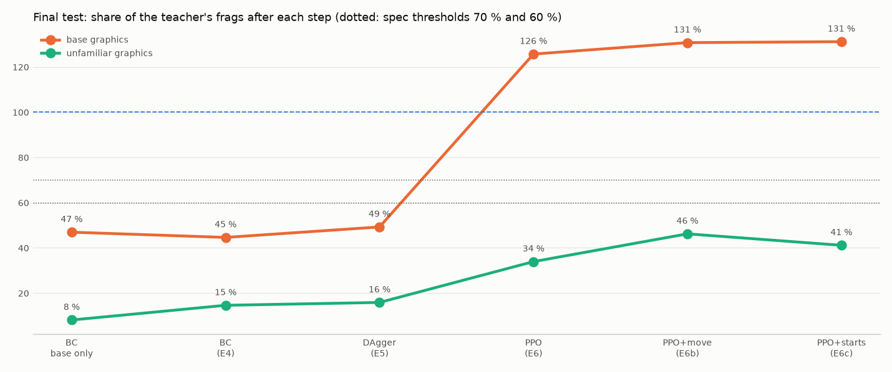

# DoomCNN: агент для ViZDoom deathmatch по пикселям

Нейросеть играет deathmatch на карте `cig.wad` MAP02 против 7 встроенных ботов ViZDoom. Она видит только экран
(4 последних серых кадра 320×240) и строку состояния: здоровье, броню, патроны, оружие. Каждый шаг сеть выбирает
четыре действия сразу: движение, поворот на точный угол, выстрел и смену оружия. Память — слой GRU.

Сеть обучена имитацией учителя-читера (behavior cloning и DAgger), а затем дообучена с подкреплением (PPO). На
финальном test на базовой графике она набирает больше фрагов, чем учитель (15.6 против 11.9, 131 %); на незнакомой
графике — 41 % учителя (лучшая модель — 52 %).

Это вторая часть курсовой. Первая часть, агент для `defend_the_center`, лежит в ветке
[`doom/defend_the_center`](https://github.com/vladislavsaltanov/DoomCNN/tree/doom/defend_the_center) и кратко описана в конце.


## Финальный test (E7)

40 матчей на базовой графике и по 8 на 6 test-вариантах графики; ни эти seed, ни эти варианты не использовались ни
в обучении, ни при выборе моделей. Отчёт: [`reports/dm/e7_test/e7_test.md`](reports/dm/e7_test/e7_test.md), галерея с видео, нейронами и картами: [`e7_gallery.md`](reports/dm/e7_test/e7_gallery.md).

| критерий спека | значение | выполнен |
|---|---|---|
| база: ≥ 70 % фрагов учителя | **131 %** (15.57 против 11.88) | да |
| незнакомая графика: ≥ 60 % учителя | 41 % (лучшая модель E6d — 52 %) | **нет** |
| незнакомая графика: значимо больше ученика только на базовой графике | +3.81 [+2.83, +4.77] | да |
| память: M1 − M0 при равных данных, точность ответа | +0.64 [+0.03, +1.20] | да |

У итоговой модели память решает многое: с памятью GRU, обнуляемой на каждом шаге, она теряет 6.3 фрага из 9.7.
Ученики проваливаются на смешанных test-вариантах (новые текстуры и новый спрайт бота вместе): 0.5–2.3 фрага против
10–12 у учителя.



## Свежие матчи (выбор моделей)

Свежие матчи: 60 матчей по 2 минуты (40 на базовой графике и 20 на незнакомых вариантах), не использованные ни в
обучении, ни при выборе модели. Фраги за матч, в скобках 95-процентный bootstrap-интервал.

| модель | метод | фраги | доля учителя | первое место из 8 |
|---|---|---|---|---|
| учитель | скрипт-читер: A*, мгновенный прицел, видит только видимых ботов | 11.65 [10.58, 12.73] | 100 % | 68 % |
| **итоговая** (`ppo_e6c_01001k`) | + PPO 1 млн шагов со случайными точками появления и наградой за редкие районы | **13.20** [11.62, 14.75] | **113 %** | 73 % |
| `ppo_explore_01001k` (E6b) | + PPO 1 млн шагов с наградой за движение по карте | 11.77 [10.40, 13.08] | 101 % | 75 % |
| `ppo_kl_03000k` (E6) | DAgger-ученик + PPO 3 млн шагов | 10.22 [8.88, 11.53] | 88 % | 68 % |
| `dagger_sp_r2` | имитация + DAgger + пространственные головы | 4.83 [3.93, 5.68] | 41 % | 25 % |
| `dm3_m1_aux` | имитация (BC) + вспомогательные головы | 4.53 [3.73, 5.35] | 39 % | 17 % |

- Итоговая модель выше учителя: разность +1.55 [−0.25, +3.30]. На базовой графике 15.60 против 12.78.
- На незнакомой графике она набирает 89 % учителя (8.4 против 9.4).
- PPO прибавил к DAgger-ученику **+6.9 фрага [+5.8, +8.2]**: +5.4 основной прогон (E6) и ещё +1.55 [+0.48, +2.62]
  дообучение со штрафами за «пятачок» и выстрелы в пустоту и наградой за новые клетки (E6b).
- Финальная проверка на test (E7) впереди. Полные отчёты по срезам — [`reports/dm/README.md`](reports/dm/README.md).

Отрицательные и спорные результаты:

- **Имитация упёрлась примерно в 40 % учителя.** Ни больше данных, ни вспомогательные и пространственные головы,
  ни DAgger не сдвинули фраги за пределы шума. Причина — скрытая цель: учитель выбирает путь по своему маршруту и
  помнит подобранное, а по картинке этого не видно. В одинаковых кадрах ученик получает противоположные метки и учит
  их среднее.
- **Подсказки учителя в PPO (kickstarting) ломают политику.** С весом 1 за 250 тыс. шагов val упал с 3.57 до 1.06,
  застревание выросло до 42 %. Работает якорь к стартовой политике (KL).
- **Большой вес данных DAgger (×5) сломал движение:** застревание выросло до 15 %.
- **Выбор модели по 20–40 матчам шумный.** Лучшая на одних матчах может оказаться последней на других. Все выводы
  делаются только по свежим матчам с парными разностями.

## Как получена итоговая модель

1. **Учитель-читер** (`doomagent.dm.teacher`).
   - Знает геометрию карты (A* по секторам) и места оружия.
   - Видит ботов только тех, что видны на экране (не меньше 50 пикселей): «читер по реакции, а не по знанию».
   - Режимы: бой, погоня, оружие, предметы, патруль.
   - Целится на точный угол за один шаг, уклоняется от снарядов, выбирает оружие по дистанции.
   - Улучшался циклом правок: каждая правка принималась только по приросту на свежих матчах.
2. **Данные:** R0 — 300 матчей на базовой графике, R1 — 192 матча на 16 вариантах графики (текстуры и спрайты),
   всего около 516 тыс. шагов.
3. **Имитация (BC):**
   - NatureCNN и GRU 512, четыре головы действий;
   - отрезки по 32 шага с прогревом памяти;
   - вспомогательные головы: бот в кадре, его столбец, предметы, клетка карты, направление, глубина;
   - отражение кадра и аугментации;
   - свёртки инициализированы итоговой моделью первой части.
4. **DAgger.** Ученик играет, учитель размечает его шаги. Лучшая ветка — с пространственными головами: карта
   проходимости вокруг, одометрия, цель учителя.
5. **PPO** (`doomagent.dm.ppo`, своя рекуррентная реализация на той же сети):
   - **асимметричный критик:** он видит привилегированный вектор (время, счёт, боты за стенами), а политика — только
     экран;
   - **якорь KL** к стартовой политике;
   - вспомогательные потери продолжаются;
   - **формирующая награда:** смерть −0.2, урон +0.005, предметы, оружие, застревание −0.01;
   - выбор действия с температурой 0.5;
   - 8 сред, 3 млн шагов, около 5 часов на RTX 3060 Ti;
   - дообучение E6b, ещё 1 млн шагов: 3/4 матчей на вариантах графики, награда за новые клетки карты, штрафы за
     «пятачок» (10 с в радиусе 192 единиц) и за выстрел при пустом экране;
   - E6c, ещё 1 млн шагов: в половине жизней бот при обучении появляется в случайной точке карты, награда за вход в
     редкие районы (оценка всегда с обычным появлением).

Журнал всех решений, замеров и сбоев: [`research_log_dm.md`](research_log_dm.md).

## Структура (deathmatch)

| путь | что там |
| --- | --- |
| `src/doomagent/dm/` | среда, учитель, навигация, запись, модель, обучение (`train`, `dagger`, `ppo`, `rlenv`), оценка, отчёты, панель |
| `scripts/dm/` | этапы, отчёты, игра и видео (`dm_play.py`, `dm_demo_video.py`), PPO (`dm_ppo.py`), сравнения |
| `tests/dm/` | тесты (pytest; помеченные `vizdoom` требуют рабочий ViZDoom) |
| `reports/dm/` | отчёты по срезам, по папке на срез, с оглавлением |
| `research_log_dm.md` | журнал исследования deathmatch |

Модели (`runs/`), данные (`data/`) и видео в репозиторий не входят: они большие и воспроизводятся скриптами.

## Запуск

Установка — как в первой части, Windows: [`WINDOWS.md`](WINDOWS.md).

```powershell
py -3.12 -m venv .venv
.venv\Scripts\python -m pip install torch --index-url https://download.pytorch.org/whl/cu132
.venv\Scripts\python -m pip install -r requirements-lock.txt
.venv\Scripts\python -m pip install -e .
.venv\Scripts\python -m pytest -q tests/dm
```

Посмотреть игру модели или записать видео (35 кадров в секунду; `--boxes`, `--hud`, `--map` рисуются только для зрителя):

```powershell
.venv\Scripts\python scripts\dm\dm_play.py --who runs\dm\e6\ppo_e6c_01001k.pt --seed 36005 --boxes --hud --map
.venv\Scripts\python scripts\dm\dm_play.py --who runs\dm\e6\ppo_e6c_01001k.pt --seed 36005 --map --no-window --record artifacts\dm\e6_ppo\demo.mp4
```

Панель: живая игра, вид сети, кривые обучения — `.venv\Scripts\python -m doomagent.dm.dashboard`, затем
http://127.0.0.1:8766.

PPO от DAgger-ученика: `.venv\Scripts\python scripts\dm\dm_ppo.py --init runs\dm\dagger_sp_r2.pt --out runs\dm\ppo_kl --temp 0.5`.

## Первая часть: defend_the_center

Ветка [`doom/defend_the_center`](https://github.com/vladislavsaltanov/DoomCNN/tree/doom/defend_the_center), журнал [`research_log.md`](research_log.md).
Код первой части лежит и здесь (`src/doomagent/`, `scripts/`, `tests/`) без изменений.

Свёрточная сеть играет `defend_the_center` по 4 кадрам 160×120. Конвейер тот же: учитель → имитация → варианты
графики → DAgger → PPO со штрафом за кручение. На test итоговая модель наравне с учителем и на базовой графике
(22.97 против 22.89), и на незнакомой (21.15 против 20.96). Отсюда в deathmatch перешли конвейер, проверка на
свежих seed с парными разностями и свёртки итоговой модели как инициализация.

## Благодарности

[ViZDoom](https://github.com/Farama-Foundation/ViZDoom), [Freedoom](https://freedoom.github.io/),
[Stable-Baselines3](https://github.com/DLR-RM/stable-baselines3), PyTorch.


Отдельное спасибо [Claude Code](https://claude.com/claude-code) (Anthropic, Opus 5.5).
