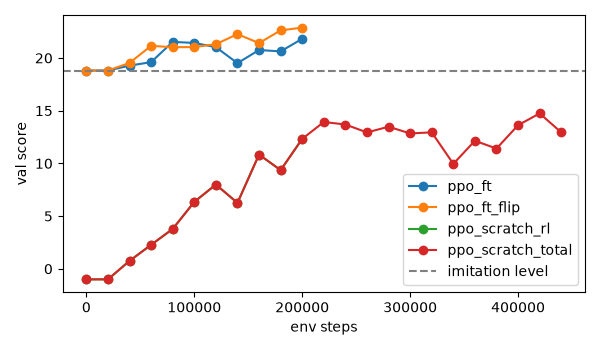
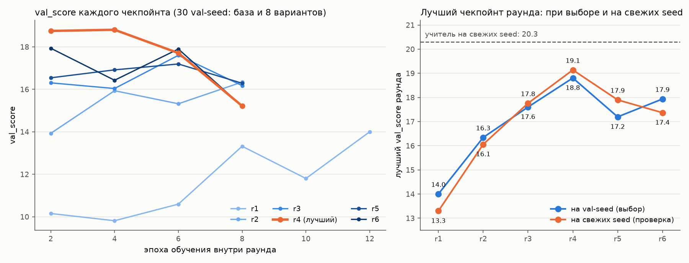

# DoomCNN: агент для ViZDoom `defend_the_center` по пикселям

Свёрточная сеть играет в ViZDoom `defend_the_center`, видя только экран: 4 последних кадра 160×120 в оттенках серого. Сеть обучена имитацией привилегированного учителя (behavior cloning и DAgger) на рандомизированной графике и дообучена с подкреплением (PPO) с формированием награды. Итоговая модель играет на уровне учителя и на базовой графике, и на графике, которой не видела.


## Итог

Проверка на test: 100 эпизодов на базовой графике (seed 9000–9099) и 11 test-вариантов графики по 20 эпизодов. Ни эти seed, ни эти варианты не использовались ни в обучении, ни при выборе моделей. Средняя награда за эпизод, в скобках 95-процентный bootstrap-интервал; потолок около 25 (26 патронов, −1 за смерть).

| модель | метод | базовая графика | незнакомая графика |
| --- | --- | --- | --- |
| учитель | скрипт по данным игры (labels buffer) | 22.89 [22.61, 23.14] | 20.96 [20.42, 21.45] |
| **итоговая** (`bc_ppo_flip`) | r4 + PPO + штраф за кручение | **22.97** [22.75, 23.19] | **21.15** [20.50, 21.72] |
| r4 + PPO | r4 + PPO | 22.97 [22.69, 23.23] | 19.74 [18.97, 20.40] |
| r4 | имитация + варианты графики + DAgger | 22.86 [22.51, 23.16] | 16.70 [15.77, 17.62] |
| r1 | имитация + варианты графики | 21.18 [20.59, 21.76] | 11.95 [10.91, 13.00] |
| bc0 | имитация, только базовая графика | 23.35 [22.63, 24.02] | 3.96 [3.41, 4.56] |
| PPO с нуля, 446 тыс. шагов | только RL, равный полный бюджет | 16.66 [16.17, 17.18] | 12.50 [11.87, 13.09] |
| PPO с нуля, 200 тыс. шагов | только RL, равный бюджет RL | 10.47 [9.33, 11.57] | 10.47 [9.84, 11.10] |

Критерии успеха из спецификации выполнены все:

| критерий | значение | выполнен |
| --- | --- | --- |
| база: итоговая не хуже учителя (верхняя граница парной разности ≥ 0) | 0.08 [−0.27, 0.46] | да |
| база: итоговая не хуже PPO с нуля (оба бюджета) | 22.97 против 10.47 и 16.66 | да |
| незнакомая графика: не меньше 80 % учителя | 21.15 против 16.77 (101 % учителя) | да |
| незнакомая графика: значимо лучше bc0 | +17.19 [16.44, 17.91] | да |

Что дал каждый шаг на незнакомой графике (парная разница с bc0): варианты графики +8.0, DAgger +12.7, PPO +15.8, PPO со штрафом за кручение +17.2. Полные таблицы, метрики игры и абляции: [`reports/s8_final.md`](reports/s8_final.md), [`results/test_report.json`](results/test_report.json).

Отрицательные и спорные результаты:

- Вспомогательные головы (видимость врага, смещение, маска) на test пользы не дали: без них на базе даже немного лучше, на незнакомой графике разницы нет.
- Модели, обученные только на базовой графике, на ней не хуже итоговой (bc0_noaux 24.08), но на незнакомой графике проваливаются (3.6–4.9).
- Штраф за кручение не potential-based, то есть формально может менять оптимальную стратегию; модели отбирались только по настоящей награде игры.
- В раундах DAgger поздние эпохи хуже на незнакомой графике (переобучение на вариантах из обучения); спасал выбор лучшего чекпойнта.

## Как получена итоговая модель

1. **Учитель.** Скрипт видит рамки врагов из labels buffer ViZDoom (данные, которых у сети нет), целится в ближайшего врага малыми поворотами и стреляет, когда тот в прицеле. Награда около 22.7 из 25. Подход: привилегированный эксперт («Learning by Cheating», Chen et al., 2019).
2. **Behavior cloning.** Датасет игры учителя (300 эпизодов, около 81 тыс. шагов; 10 % действий заменены случайным поворотом, чтобы в данных было восстановление после сбитого прицела). CNN в стиле Nature-DQN (3 свёртки и полносвязный слой 512), кросс-энтропия по действиям учителя, вспомогательные задачи по данным игры, отражение кадра, выбор чекпойнта по игре, а не по потерям.
3. **Рандомизация графики.** 49 вариантов: процедурные текстуры стен, пола и потолка и подмена спрайтов обоих типов врагов; разбиение train / val / test.
4. **DAgger** (Ross et al., 2011). Играет ученик, учитель размечает его шаги, данные копятся; раунды r2–r6 по 100 эпизодов на случайных вариантах графики, правило остановки (два раунда без прироста больше 0.5). Лучший раунд: r4.
5. **PPO** (Schulman et al., 2017; Stable-Baselines3). Старт с весов r4, отдельный экстрактор критика, 20 тыс. шагов разогрева критика при замороженной политике, малый шаг обучения. К награде игры добавлен штраф −0.1 за смену направления поворота, пока врага на экране нет (данные игры используются только для подсчёта награды). 200 тыс. шагов; лучшая модель по настоящей награде игры на val.

Подробный журнал всех решений, замеров и сбоев: [`research_log.md`](research_log.md).

<p align="center"> </p>

## Структура

| путь | что там |
| --- | --- |
| `src/doomagent/` | среда, учитель, датасет, модель, обучение (`train_bc`, `dagger`, `ppo`), оценка, отчёты, HUD, визуализация сети, панель |
| `scripts/` | запуск этапов, отчёты и графики (`s*_*.py`), игра в окне (`play.py`), демо-видео (`demo_video.py`) |
| `tests/` | тесты (pytest; помеченные `vizdoom` требуют рабочий ViZDoom) |
| `variants/*.json` | описания вариантов графики (сами WAD генерируются `scripts/make_variants.py`) |
| `reports/`, `results/` | отчёты и графики этапов, итоговый test-отчёт |
| `research_log.md` | журнал исследования по срезам S0–S8 |

Модели (`runs/`), датасеты (`data/`), WAD вариантов и видео (`artifacts/*.mp4`) в репозиторий не входят: они большие и воспроизводятся скриптами.

## Запуск

Windows: [`WINDOWS.md`](WINDOWS.md). Кратко:

```powershell
py -3.12 -m venv .venv
.venv\Scripts\python -m pip install torch --index-url https://download.pytorch.org/whl/cu132
.venv\Scripts\python -m pip install -r requirements-lock.txt
.venv\Scripts\python -m pip install -e .
.venv\Scripts\python -m pytest -q
```

Посмотреть, как играет модель (нужен файл модели в `runs/`; `--hud` рисует полосу статуса Doom для зрителя, сеть её не видит):

```powershell
.venv\Scripts\python scripts\play.py --who runs\ppo_ft_flip\best_model.zip --variant tex_test_00 --seed 9001 --episodes 3 --hud
```

Панель с живой игрой, картами активаций сети в реальном времени, кривыми обучения и нагрузкой компьютера:

```powershell
.venv\Scripts\python -m doomagent.dashboard
```

Затем откройте http://127.0.0.1:8765 (вид сети на весь экран: http://127.0.0.1:8765/brain).

Порядок этапов и команды каждого — в `research_log.md` (раздел «Команда» в каждой записи).

## Благодарности

[ViZDoom](https://github.com/Farama-Foundation/ViZDoom), [Freedoom](https://freedoom.github.io/) (графика и полоса статуса), [Stable-Baselines3](https://github.com/DLR-RM/stable-baselines3), PyTorch.


Отдельное спасибо [Claude Code](https://claude.com/claude-code) (Anthropic, Opus 5.5).
