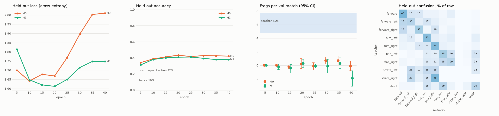

# D2: pilot M0 and M1

Data: data/dm_pilot, 10 teacher matches, 10492 steps (5% of matches held out). Validation: 10 base matches (VAL_SEEDS[:10]) every 5 epochs. Teacher on the 20 val seeds (D1): 6.25 [4.80, 7.70] frags.

| run | epochs | minutes | held-out CE first → last | train acc last | held-out acc best | most frequent action | best val frags (epoch) | stuck at best |
|---|---|---|---|---|---|---|---|---|
| M0 | 40 | 12.4 | 1.70 → 2.01 (min 1.64) | 0.78 | 0.43 | 0.22 | 0.7 [0.2, 1.2] (30) | 50% |
| M1 | 40 | 14.1 | 1.81 → 1.75 (min 1.61) | 0.81 | 0.41 | 0.22 | 0.3 [-0.3, 0.9] (20) | 53% |

Held-out accuracy per action, last epoch (chance 0.10):

| action | M0 | M1 |
|---|---|---|
| forward | 0.57 | 0.47 |
| forward_left | 0.23 | 0.30 |
| forward_right | 0.36 | 0.36 |
| turn_left | 0.50 | 0.44 |
| turn_right | 0.49 | 0.43 |
| fine_left | 0.32 | 0.36 |
| fine_right | 0.39 | 0.29 |
| strafe_left | 0.00 | 0.00 |
| strafe_right | 0.00 | 0.00 |
| shoot | 0.34 | 0.29 |

