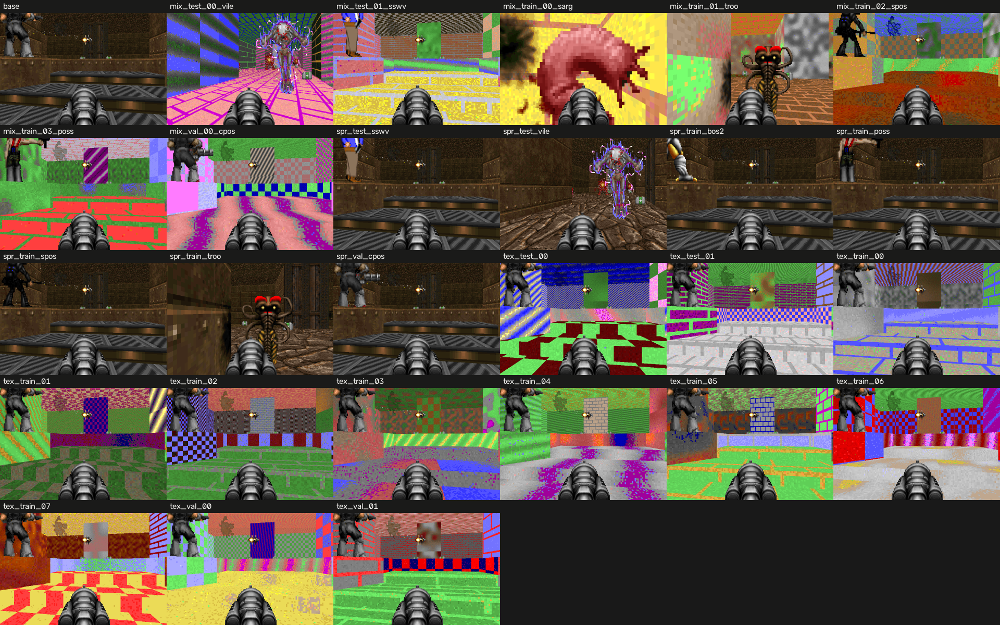

# D3: graphics variants of cig MAP01

Teacher on CHECK_SEEDS (6 matches per variant). Base: frags 5.00 [3.33, 6.83], K/D 1.11. A variant is switched off below 0.7 of the base frags, or (tex, mix) with a mean network-frame difference from the base below 8 (first 20 steps of a fixed walk).

| variant | split | kind | frags [95% CI] | of base | K/D | frame diff | status |
|---|---|---|---|---|---|---|---|
| mix_test_00_vile | test | mix | 5.33 [3.33, 7.83] | 1.07 | 1.28 | 52.6 | ok |
| mix_test_01_sswv | test | mix | 8.83 [7.00, 11.00] | 1.77 | 2.79 | 59.6 | ok |
| mix_train_00_sarg | train | mix | 5.50 [3.33, 8.00] | 1.10 | 1.27 | 69.5 | ok |
| mix_train_01_troo | train | mix | 5.67 [3.50, 7.83] | 1.13 | 1.31 | 61.1 | ok |
| mix_train_02_spos | train | mix | 5.50 [2.67, 8.33] | 1.10 | 1.50 | 64.0 | ok |
| mix_train_03_poss | train | mix | 5.67 [2.83, 8.67] | 1.13 | 1.89 | 70.6 | ok |
| mix_val_00_cpos | val | mix | 5.50 [3.33, 7.67] | 1.10 | 1.65 | 65.2 | ok |
| spr_test_sswv | test | spr | 8.83 [7.00, 11.00] | 1.77 | 2.79 | 0.0 | ok |
| spr_test_vile | test | spr | 5.33 [3.33, 7.83] | 1.07 | 1.28 | 0.0 | ok |
| spr_train_bos2 | train | spr | 6.17 [4.83, 7.67] | 1.23 | 1.28 | 0.0 | ok |
| spr_train_poss | train | spr | 5.67 [2.83, 8.67] | 1.13 | 1.89 | 0.0 | ok |
| spr_train_spos | train | spr | 5.50 [2.67, 8.33] | 1.10 | 1.50 | 0.0 | ok |
| spr_train_troo | train | spr | 5.67 [3.50, 7.83] | 1.13 | 1.31 | 0.0 | ok |
| spr_val_cpos | val | spr | 5.50 [3.33, 7.67] | 1.10 | 1.65 | 0.0 | ok |
| tex_test_00 | test | tex | 5.00 [3.33, 6.83] | 1.00 | 1.11 | 47.1 | ok |
| tex_test_01 | test | tex | 5.00 [3.33, 6.83] | 1.00 | 1.11 | 67.1 | ok |
| tex_train_00 | train | tex | 5.00 [3.33, 6.83] | 1.00 | 1.11 | 63.2 | ok |
| tex_train_01 | train | tex | 5.00 [3.33, 6.83] | 1.00 | 1.11 | 61.2 | ok |
| tex_train_02 | train | tex | 5.00 [3.33, 6.83] | 1.00 | 1.11 | 56.5 | ok |
| tex_train_03 | train | tex | 5.00 [3.33, 6.83] | 1.00 | 1.11 | 55.2 | ok |
| tex_train_04 | train | tex | 5.00 [3.33, 6.83] | 1.00 | 1.11 | 76.5 | ok |
| tex_train_05 | train | tex | 5.00 [3.33, 6.83] | 1.00 | 1.11 | 56.9 | ok |
| tex_train_06 | train | tex | 5.00 [3.33, 6.83] | 1.00 | 1.11 | 64.9 | ok |
| tex_train_07 | train | tex | 5.00 [3.33, 6.83] | 1.00 | 1.11 | 65.8 | ok |
| tex_val_00 | val | tex | 5.00 [3.33, 6.83] | 1.00 | 1.11 | 81.7 | ok |
| tex_val_01 | val | tex | 5.00 [3.33, 6.83] | 1.00 | 1.11 | 66.2 | ok |

26 of 26 variants kept.

