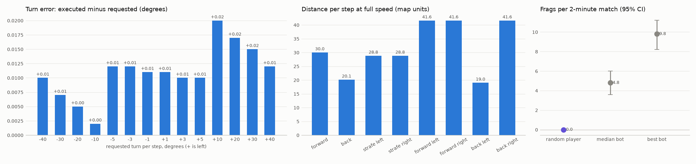

# E0: cig MAP02 environment

Turns (requested → executed, degrees): worst error 0.020. -40 → -39.99, -30 → -29.99, -20 → -20.00, -10 → -10.00, -5 → -4.99, -3 → -2.99, -1 → -0.99, +1 → +1.01, +3 → +3.01, +5 → +5.01, +10 → +10.02, +20 → +20.02, +30 → +30.02, +40 → +40.01

Moves at full speed (map units per step): forward 30.0, back 20.1, strafe_left 28.8, strafe_right 28.8, forward_left 41.6, forward_right 41.6, back_left 19.0, back_right 41.6

Walks to the nearest weapon (A*): 6 of 6 reached; auto-switch on pickup in 6 of 6. seed 35000 Chaingun: slot 4 after 16 steps, in hand [2, 2, 2, 4, 4, 4]; seed 35001 PlasmaRifle: slot 6 after 25 steps, in hand [2, 2, 2, 6, 6, 6]; seed 35002 SuperShotgun: slot 3 after 18 steps, in hand [2, 2, 2, 3, 3, 3]; seed 35003 PlasmaRifle: slot 6 after 25 steps, in hand [2, 2, 2, 6, 6, 6]; seed 35004 SuperShotgun: slot 3 after 18 steps, in hand [2, 2, 2, 3, 3, 3]; seed 35005 PlasmaRifle: slot 6 after 25 steps, in hand [2, 2, 2, 6, 6, 6]

Projectile speeds (map units per tic, median over object tracks): PlasmaBall 25.0 (n=296), Rocket 20.0 (n=25)

Map MAP02: 530 linedefs, specials {182: 2}

Same seed twice, same random actions: frames identical = True; 8.22 ms per step.

Random player on VAL_SEEDS[:5]: player 0.00 [0.00, 0.00], median bot 4.80 [3.60, 6.00], best bot 9.80 [8.20, 11.20] frags per match.

