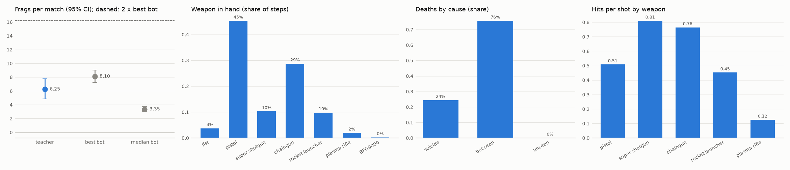

# E1: cheater teacher on the val matches (MAP02)

Command: `python scripts/dm/dm_teacher_report.py --diag runs/dm/cycle/d41d8cd98f_val20.json`

Matches: 20 (base graphics, VAL_SEEDS)

| player | frags [95% CI] | deaths | K/D (mean, total) | suicides | hits per shot | items | path | stuck | sees a bot | median bot's frags [95% CI] |
| --- | --- | --- | --- | --- | --- | --- | --- | --- | --- | --- |
| teacher | 6.25 [4.85, 7.75] | 2.4 | 3.26, 2.60 | 0.5 | 0.55 | 5.0 | 19076 | 0.1% | 67% | 3.35 [3.00, 3.70] |
| random | -0.20 [-0.40, -0.05] | 1.6 | -0.11, -0.12 | 0.2 | 0.04 | 2.9 | 13139 | 5.2% | 16% | 3.90 [3.40, 4.45] |

Best bot of the match: 8.10 [7.20, 9.00] frags; first of 8 in 25 % of matches.

## Gate A v2

- FAIL: K/D over all matches >= 3: 2.6041666666666665
- FAIL: first of 8 in >= 90 % of matches: 0.25
- FAIL: frags >= 2 x the best bot's frags: (6.25, 8.1)

## Teacher decisions (share of steps)

combat 66%, chase 7%, gear 14%, items 1%, patrol 12%

## Weapon in hand (share of steps)

fist 4%, pistol 45%, super shotgun 10%, chaingun 29%, rocket launcher 10%, plasma rifle 2%, BFG9000 0%

## Diagnostics (runs/dm/cycle/d41d8cd98f_val20.json)

Deaths by cause: suicide 24%, bot seen 76%, unseen 0%

Hits per shot by weapon: pistol 0.51 (762 shots), super shotgun 0.81 (84 shots), chaingun 0.76 (1435 shots), rocket launcher 0.45 (62 shots), plasma rifle 0.12 (24 shots)

Bot on screen, by the reason not to fire: shoot 18%, switching 3%, not_aimed 69%, unsafe 0%, no_ammo 0%, reloading 9%, no_combat 1%

Teacher frags per match: 5 3 9 4 9 3 5 7 7 7 9 10 2 2 11 3 4 2 12 11

Best bot per match: 7 7 10 11 10 6 7 10 10 12 9 5 5 7 6 8 10 8 6 8

