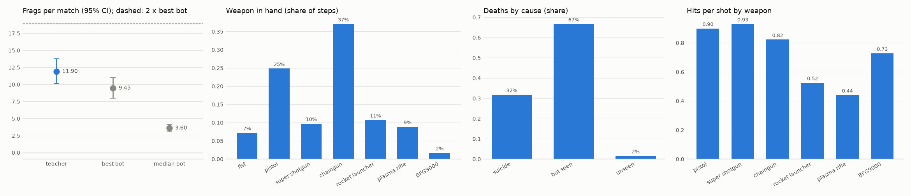

# E1: cheater teacher on the val matches (MAP02)

Command: `python scripts/dm/dm_teacher_report.py --diag runs/dm/diag_final_val.json --workers 4 --out reports/dm/e1_teacher_final`

Matches: 20 (base graphics, VAL_SEEDS)

| player | frags [95% CI] | deaths | K/D (mean, total) | suicides | hits per shot | items | path | stuck | sees a bot | median bot's frags [95% CI] |
| --- | --- | --- | --- | --- | --- | --- | --- | --- | --- | --- |
| teacher | 11.90 [10.10, 13.75] | 3.5 | 4.72, 3.35 | 1.0 | 0.50 | 6.8 | 20459 | 1.0% | 56% | 3.60 [3.05, 4.10] |
| random | -0.10 [-0.25, 0.00] | 1.6 | -0.05, -0.06 | 0.1 | 0.02 | 2.5 | 13144 | 4.5% | 16% | 3.95 [3.40, 4.55] |

Best bot of the match: 9.45 [8.00, 10.95] frags; first of 8 in 65 % of matches.

## Gate A v2.1 (revised 2026-10-23)

- PASS: K/D over all matches >= 3: 3.352112676056338
- PASS: first of 8 in >= 50 % of matches: 0.65
- PASS: frags - best bot, upper 95% bound >= 0: (2.45, -0.2, 5.05)

## Teacher decisions (share of steps)

combat 47%, chase 12%, gear 16%, items 5%, patrol 21%

## Weapon in hand (share of steps)

fist 7%, pistol 25%, super shotgun 10%, chaingun 37%, rocket launcher 11%, plasma rifle 9%, BFG9000 2%

## Diagnostics (runs/dm/diag_final_val.json)

Deaths by cause: suicide 32%, bot seen 67%, unseen 2%

Hits per shot by weapon: pistol 0.90 (266 shots), super shotgun 0.93 (85 shots), chaingun 0.82 (3767 shots), rocket launcher 0.52 (141 shots), plasma rifle 0.44 (298 shots), BFG9000 0.73 (11 shots)

Bot on screen, by the reason not to fire: shoot 44%, switching 3%, not_aimed 11%, unsafe 0%, no_ammo 0%, reloading 24%, no_combat 18%

Teacher frags per match: 14 10 10 12 7 19 21 9 14 12 15 11 12 5 18 15 7 6 8 13

Best bot per match: 8 14 10 6 8 6 5 14 5 13 6 10 9 13 9 15 12 6 6 14

