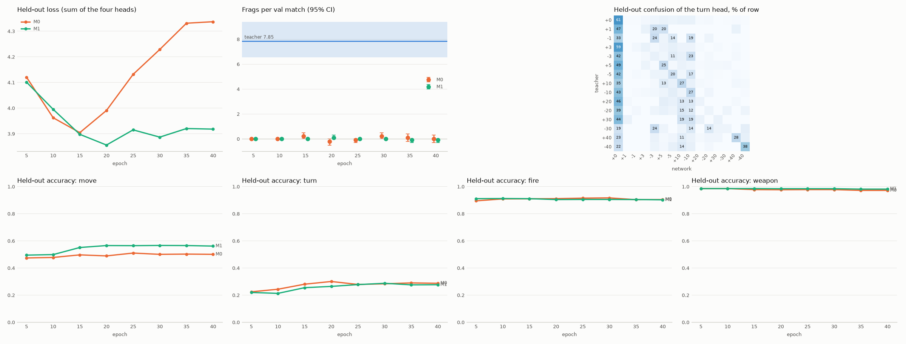

# E2: pilot M0 and M1 with four heads

Data: data/dm/pilot, 10 teacher matches, 10495 steps (5% of matches held out). Validation: 10 base matches (VAL_SEEDS[:10]) every 5 epochs. Teacher on the 20 val seeds (E1): 7.85 [6.55, 9.40] frags.

| run | epochs | minutes | held-out CE first → last (min) | best val frags (epoch) | stuck at best |
|---|---|---|---|---|---|
| M0 | 40 | 12.1 | 4.12 → 4.34 (3.90) | 0.2 [0.0, 0.5] (15) | 28% |
| M1 | 40 | 13.2 | 4.10 → 3.92 (3.86) | 0.1 [0.0, 0.3] (20) | 45% |

Held-out accuracy per head (best epoch) against the share of its most frequent label:

| head | M0 accuracy | M1 accuracy | most frequent label |
|---|---|---|---|
| move | 0.51 | 0.57 | 0.30 |
| turn | 0.30 | 0.29 | 0.21 |
| fire | 0.92 | 0.91 | 0.91 |
| weapon | 0.98 | 0.98 | 0.98 |

