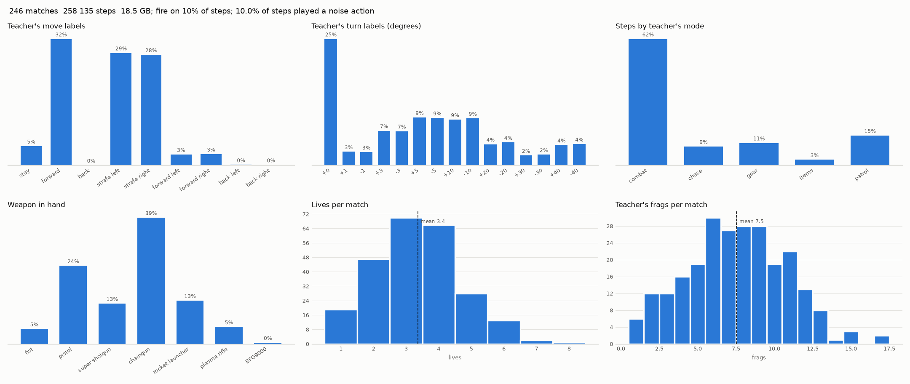

# E3: recorded teacher matches, cig MAP02

| set | matches | steps | GB | steps per match | lives per match | teacher frags per match | noise share | variants |
|---|---|---|---|---|---|---|---|---|
| data/dm/r0 | 150 | 157402 | 11.3 | 1049 | 3.3 | 7.41 | 0.099 | 1 |
| data/dm/r1 | 96 | 100733 | 7.2 | 1049 | 3.5 | 7.75 | 0.101 | 16 |
| all | 246 | 258135 | 18.5 | 1049 | 3.4 | 7.54 | 0.100 | 17 |

| move | share of labels |
|---|---|
| stay | 4.9% |
| forward | 32.3% |
| back | 0.0% |
| strafe_left | 28.7% |
| strafe_right | 28.3% |
| forward_left | 2.8% |
| forward_right | 2.8% |
| back_left | 0.1% |
| back_right | 0.1% |

| turn (degrees) | share of labels |
|---|---|
| +0 | 24.6% |
| +1 | 2.6% |
| -1 | 2.6% |
| +3 | 6.7% |
| -3 | 6.6% |
| +5 | 9.3% |
| -5 | 9.2% |
| +10 | 8.9% |
| -10 | 9.1% |
| +20 | 4.1% |
| -20 | 4.4% |
| +30 | 1.9% |
| -30 | 2.1% |
| +40 | 3.9% |
| -40 | 4.1% |

Fire on 10.4% of steps, next weapon on 2.8%.

| weapon in hand | share of steps |
|---|---|
| fist | 4.6% |
| pistol | 24.3% |
| super shotgun | 12.6% |
| chaingun | 39.3% |
| rocket launcher | 13.5% |
| plasma rifle | 5.3% |
| BFG9000 | 0.4% |

| teacher mode | share of steps |
|---|---|
| combat | 62.3% |
| chase | 9.3% |
| gear | 11.0% |
| items | 2.7% |
| patrol | 14.7% |

