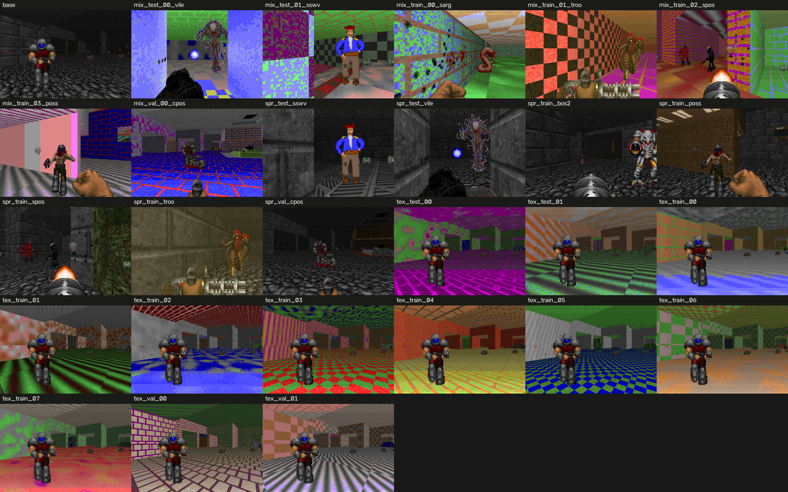

# E3: graphics variants of cig MAP02

Teacher on CHECK_SEEDS (6 matches per variant). Base: frags 14.00 [10.00, 17.67], K/D 3.65. A variant is switched off below 0.7 of the base frags, or (tex, mix) with a mean network-frame difference from the base below 8 (first 20 steps of a fixed walk).

| variant | split | kind | frags [95% CI] | of base | K/D | frame diff | status |
|---|---|---|---|---|---|---|---|
| mix_test_00_vile | test | mix | 11.17 [7.83, 14.67] | 0.80 | 3.72 | 46.0 | ok |
| mix_test_01_sswv | test | mix | 14.17 [11.83, 16.84] | 1.01 | 3.86 | 42.3 | ok |
| mix_train_00_sarg | train | mix | 16.17 [13.00, 19.33] | 1.15 | 5.11 | 48.7 | ok |
| mix_train_01_troo | train | mix | 17.17 [13.66, 21.17] | 1.23 | 4.48 | 41.5 | ok |
| mix_train_02_spos | train | mix | 14.00 [9.67, 18.83] | 1.00 | 4.20 | 38.5 | ok |
| mix_train_03_poss | train | mix | 11.83 [9.67, 14.00] | 0.85 | 3.23 | 34.5 | ok |
| mix_val_00_cpos | val | mix | 10.00 [7.50, 13.17] | 0.71 | 2.61 | 47.6 | ok |
| spr_test_sswv | test | spr | 14.17 [11.83, 16.84] | 1.01 | 3.86 | 0.1 | ok |
| spr_test_vile | test | spr | 11.17 [7.83, 14.67] | 0.80 | 3.72 | 0.3 | ok |
| spr_train_bos2 | train | spr | 11.50 [6.83, 16.17] | 0.82 | 3.29 | 0.2 | ok |
| spr_train_poss | train | spr | 11.83 [9.67, 14.00] | 0.85 | 3.23 | 0.1 | ok |
| spr_train_spos | train | spr | 14.00 [9.67, 18.83] | 1.00 | 4.20 | 0.1 | ok |
| spr_train_troo | train | spr | 17.17 [13.66, 21.17] | 1.23 | 4.48 | 0.1 | ok |
| spr_val_cpos | val | spr | 10.00 [7.50, 13.17] | 0.71 | 2.61 | 0.1 | ok |
| tex_test_00 | test | tex | 14.00 [10.00, 17.67] | 1.00 | 3.65 | 59.8 | ok |
| tex_test_01 | test | tex | 14.00 [10.00, 17.67] | 1.00 | 3.65 | 45.3 | ok |
| tex_train_00 | train | tex | 14.00 [10.00, 17.67] | 1.00 | 3.65 | 45.7 | ok |
| tex_train_01 | train | tex | 14.00 [10.00, 17.67] | 1.00 | 3.65 | 61.2 | ok |
| tex_train_02 | train | tex | 14.00 [10.00, 17.67] | 1.00 | 3.65 | 51.3 | ok |
| tex_train_03 | train | tex | 14.00 [10.00, 17.67] | 1.00 | 3.65 | 38.9 | ok |
| tex_train_04 | train | tex | 14.00 [10.00, 17.67] | 1.00 | 3.65 | 56.6 | ok |
| tex_train_05 | train | tex | 14.00 [10.00, 17.67] | 1.00 | 3.65 | 59.3 | ok |
| tex_train_06 | train | tex | 14.00 [10.00, 17.67] | 1.00 | 3.65 | 53.5 | ok |
| tex_train_07 | train | tex | 14.00 [10.00, 17.67] | 1.00 | 3.65 | 68.1 | ok |
| tex_val_00 | val | tex | 14.00 [10.00, 17.67] | 1.00 | 3.65 | 59.4 | ok |
| tex_val_01 | val | tex | 14.00 [10.00, 17.67] | 1.00 | 3.65 | 49.6 | ok |

26 of 26 variants kept.

