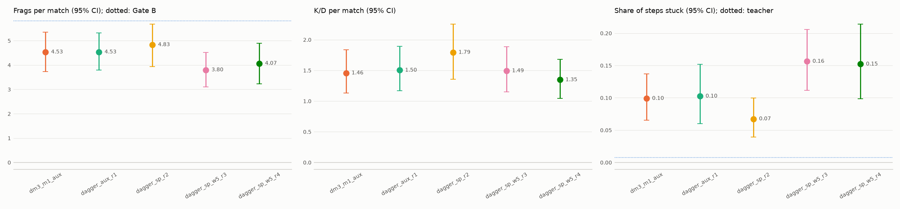

# E5: DAgger (ученик играет, учитель размечает)

**Прироста нет.** Лучшая модель E5, `dagger_sp_r2`, набирает 4.83 фрага на свежих seed (41 % учителя).
Это +0.30 [−0.68, +1.32] к стартовой `dm3_m1_aux` (4.53, 39 %), разница в пределах шума. До Gate B (50 %, 5.83) не хватает
одного фрага за матч. Увеличенный вес данных DAgger (ветка `sp_w5`) сделал хуже.

## Что делалось

Раунд DAgger:
- лучшая модель играет 40 матчей `dagger_plan(r)`, половину на базовой карте, половину на train-вариантах;
- учитель в тени размечает каждый шаг по всем головам, включая вспомогательные и пространственные: цель и направление
  учителя, расстояние до стен, карта вокруг;
- модель дообучается от лучшей на R0 + R1 + все раунды ветки: 3 эпохи, lr 1e-4, val после каждой эпохи;
- `stop_rule` останавливает ветку, когда два раунда подряд дают меньше 5 % фрагов учителя прироста.

В раунде 1 действие учителя исполнялось с вероятностью 0.3, дальше всегда играл ученик. Раунд — 40 матчей, около 42 тысяч шагов.

| ветка | старт | головы | данные раундов | раунды (val_score лучшей эпохи) | остановка |
|---|---|---|---|---|---|
| aux | dm3_m1_aux (val 2.61) | действия + aux | вес 1 | r1 3.37, r2 3.26, r3 3.31 | после r3, лучший r1 |
| sp (идея руководителя) | dm3_m1_aux | + пространственные | вес 1, r1 общий с aux | r1 3.15, r2 3.57 | после r2, лучший r2 |
| sp_w5 | dagger_sp_r2 (val 3.57) | + пространственные | вес 5 (каждое окно раундов в 5 раз чаще) | r3 2.70, r4 3.32 | после r4, лучший — старт |

Почему вес 5: при весе 1 данные раунда — около 8 % эпохи (42 тысячи шагов против 258 тысяч в R0 + R1). Ученик мог просто
не успевать учиться на своих ошибках.

## Свежие seed (те же 60 матчей, что в E4)

| модель | фраги [95 % ДИ] | доля учителя | K/D | попадания | застревание | путь |
|---|---|---|---|---|---|---|
| учитель | 11.65 [10.58, 12.73] | 100 % | 4.21 | 0.50 | 0.8 % | 20 635 |
| dm3_m1_aux (старт, E4) | 4.53 [3.73, 5.35] | 39 % | 1.46 | 0.33 | 9.9 % | 19 078 |
| dagger_aux_r1 | 4.53 [3.80, 5.32] | 39 % | 1.50 | 0.38 | 10.2 % | 18 848 |
| **dagger_sp_r2** | **4.83 [3.93, 5.68]** | **41 %** | **1.79** | 0.40 | **6.7 %** | 18 508 |
| dagger_sp_w5_r3 | 3.80 [3.10, 4.52] | 33 % | 1.49 | 0.43 | 15.6 % | 13 276 |
| dagger_sp_w5_r4 | 4.07 [3.23, 4.90] | 35 % | 1.35 | 0.41 | 15.2 % | 12 956 |

Ветки aux и sp на свежих seed проверялись только лучшей по val моделью: проверку всех моделей раундов скрипт стал делать
позже. Отчёты: `e5_fresh_aux.json`, `e5_fresh_sp.json`, `e5_fresh_sp_w5.json`. Парные разности: `e5_pairs.json`.
График: `e5_rounds.png` (`scripts/dm/dm_e5_report.py`).

| сравнение | разность фрагов [95 % ДИ] |
|---|---|
| dagger_aux_r1 − dm3_m1_aux (DAgger без пространственных голов) | +0.00 [−1.00, +0.98] |
| dagger_sp_r2 − dm3_m1_aux (DAgger с пространственными головами) | +0.30 [−0.68, +1.32] |
| dagger_sp_r2 − dagger_aux_r1 (пространственные головы при DAgger) | +0.30 [−0.73, +1.32] |
| dagger_sp_w5_r3 − dagger_sp_r2 (вес 5, раунд 3) | −1.03 [−2.02, +0.00] |
| dagger_sp_w5_r4 − dagger_sp_r2 (вес 5, раунд 4) | −0.77 [−1.85, +0.35] |

## Что видно

- **DAgger в этом виде фрагов не прибавил.** Ни одна разность не выходит за ноль.
- **Пространственные головы с DAgger — единственная ветка с улучшениями.** Застревание у `dagger_sp_r2` 6.7 % против 9.9 %,
  K/D 1.79 против 1.46, попадания 0.40 против 0.33. Но на фраги это не перешло, и эти показатели тоже в пределах интервалов.
- **Вес 5 сломал движение.** Застревание выросло вдвое (15 %), путь за матч упал на треть (13 тысяч против 18.5).
  Точность на отложенных данных учителя тоже упала: поворот 0.47 против 0.49, движение 0.75 против 0.78. Метки учителя в
  состояниях ученика другие: учитель в них перестраивает маршрут, разворачивается, отходит от стены. Когда таких меток
  много, сеть учит что-то среднее между двумя стилями.
- **Ученик и учитель расходятся почти на каждом шаге.** В матчах раундов 2–4 все четыре головы ученика совпадают с
  меткой учителя только в 12–16 % шагов: движение 40–47 %, поворот 26–31 %. На данных самого учителя совпадение по
  повороту 47–49 %. Значит, в своих состояниях ученик ошибается чаще, чем показывает отложенная выборка. Это ровно та
  проблема, которую лечит DAgger, но трёх раундов по 40 матчей не хватает, чтобы её сдвинуть.
- **Val-оценка снова не совпала со свежими seed.** val_score раундов 2.70–3.57 (20 матчей) скачет от эпохи к эпохе на
  ±1 фраг. Выбор лучшей модели по нему почти случайный.

## Вывод

Gate B не пройден и после E5. Рабочая модель — `dagger_sp_r2` (41 %, меньше застреваний). Обучение подражанием упёрлось
примерно в 40 % учителя: ни новые данные (E4, фаза 4), ни головы, ни DAgger не сдвинули фраги за пределы шума.

Варианты дальше (решение руководителя):
1. **PPO от `dagger_sp_r2` (E6 по плану)** с наградой за фраги и штрафом за застревание. Это «подкрепление»,
   которое предлагал руководитель: агент учится не копировать учителя, а набирать фраги сам. По плану это следующий этап.
2. Продолжить DAgger дольше: 10+ раундов с весом 1–2 и больше матчей в раунде. Медленно (около 25 минут на раунд),
   и по E5 прирост на раунд не виден.
3. Упростить задачу копирования: убрать из меток повороты учителя при перестройке маршрута или сгладить их. Требует
   правок записи и перезаписи данных.
