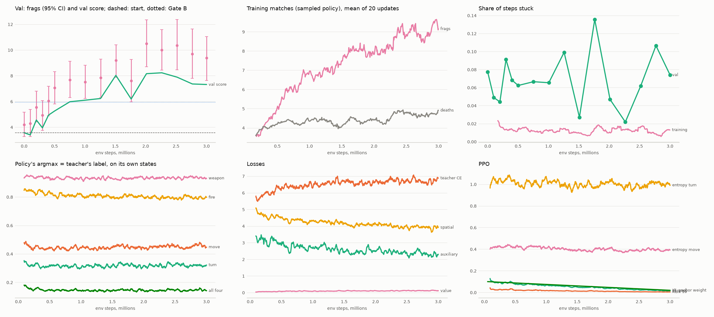
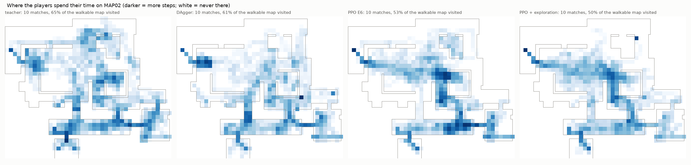
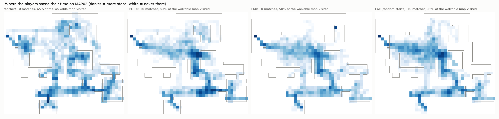
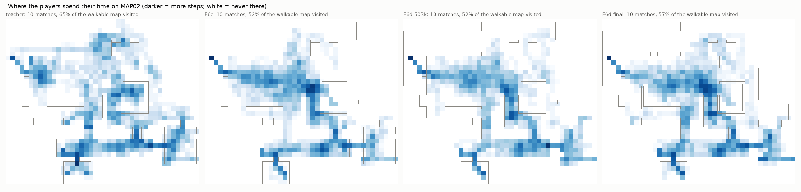

# E6: PPO от DAgger-ученика

**Gate C пройден, Gate B тоже.** PPO поднял ученика с 41 % до 85–93 % фрагов учителя на 60 свежих матчах:

- `ppo_kl_02265k`, выбранный по val: 9.88 фрага, 85 %;
- финальная модель: 10.22, 88 %;
- лучшая из четырёх: 10.78, 93 %.

Прирост к старту `dagger_sp_r2` +5.0…+6.0 фрага, интервалы далеко от нуля. На базовой графике ученик сравнялся с
учителем. На незнакомой (val-варианты) он набирает около половины учителя.

## Что делалось

Свой рекуррентный PPO на самой `DMNet` (M1, GRU с обнулением после смерти). Проект: `docs/E6_PPO_проект.md`;
код: `doomagent.dm.ppo`, `doomagent.dm.rlenv`, `scripts/dm/dm_ppo.py`.

- **Старт:** `dagger_sp_r2` (E5).
- **Прогрев:** 50 тыс. шагов учится только критик. Первая оценка до обновлений совпала со стартом (val 3.57).
- **Асимметричный критик:** MLP на признаках политики (без градиента в них), векторе и привилегированном векторе —
  время матча, счёт, боты рядом в том числе за стенами, позиция, режим учителя. Объяснённая дисперсия 0.5–0.8.
- **Вспомогательные и пространственные потери** продолжаются на шагах роллаута, цели считаются на лету.
- **Награда:** фраг +1 (самоубийство −1), смерть −0.2, урон +0.005 за единицу, предмет +0.02, новое оружие +0.1,
  застревание −0.01 за шаг. Оценка и выбор — только по фрагам.
- **Температура выборки 0.5.** Замер на замороженной политике: при τ = 1 1.6 фрага за матч, при 0.5 — 3.3, при 0.25 —
  3.85.
- **Среды:** 8 процессов без torch (ViZDoom и учитель в тени), около 170 шагов в секунду. Половина матчей на базовой
  графике, половина на train-вариантах. С 500 тыс. шагов прогон шёл на скрытом рабочем столе
  (`scripts/dm/run_hidden.py`): окна ViZDoom забирали фокус.
- **Бюджет:** 3 млн шагов, около 5 ч, плюс оценки.

### Первый прогон с подсказками учителя провалился

Прогон `runs/dm/ppo_ks`: кросс-энтропия к меткам учителя на состояниях ученика с весом 1 → 0.1 (kickstarting). К 250 тыс.
шагов val упал с 3.57 до 1.06, застревание по argmax выросло до 42 %.

Код при этом верен. Проход по отрезкам буфера даёт те же log-вероятности, что при игре (расхождение 1e-3),
вспомогательные цели правильные.

Причина в рецепте. Метки учителя на чужих состояниях зависят от его маршрута, которого нет на картинке: это урок E5
(вес 5), только сильнее. Сеть учит смесь меток, и argmax вырождается. Якорь заменён на **KL к стартовой политике** с
весом 0.1 → 0.02.

## Кривые (`e6_ppo_kl.png`)

| шаги, млн | 0 | 0.5 | 1.0 | 1.5 | 2.0 | 2.27 | 2.5 | 2.77 | 3.0 |
|---|---|---|---|---|---|---|---|---|---|
| val score | 3.57 | 5.26 | 6.10 | 8.03 | 8.16 | **8.23** | 7.89 | 7.36 | 7.32 |
| фраги val (40 матчей) | 4.20 | 7.08 | 7.53 | 9.20 | 10.50 | 10.00 | 10.35 | 9.70 | 9.38 |

- **Фраги в учебных матчах** (политика с выборкой) росли почти ровно: ~3.6 → ~9.5. Застревание там около 1 %.
- **Совпадение argmax политики с меткой учителя** на её собственных состояниях не росло: по всем головам ~15 %,
  поворот ~32 %. Кросс-энтропия к учителю выросла с 5.8 до 6.9: PPO нашёл свой способ играть, а не копию учителя.
- **Энтропия поворота** держится около 1.0, клиппинг падает к концу. Скачков нет.

## Свежие seed (те же 60 матчей, что в E4 и E5)

| модель | фраги [95 % ДИ] | доля учителя | K/D | попадания | застревание | первое из 8 | смерти |
|---|---|---|---|---|---|---|---|
| учитель | 11.65 [10.58, 12.73] | 100 % | 3.48 | 0.50 | 0.8 % | 68 % | 3.35 |
| dm3_m1_aux (E4) | 4.53 [3.73, 5.35] | 39 % | 1.14 | 0.33 | 9.9 % | 17 % | 3.97 |
| dagger_sp_r2 (E5, старт) | 4.83 [3.93, 5.68] | 41 % | 1.46 | 0.40 | 6.7 % | 25 % | 3.30 |
| ppo_kl_01509k | 9.35 [8.13, 10.58] | 80 % | 2.43 | 0.43 | 5.3 % | 63 % | 3.85 |
| ppo_kl_02013k | **10.78 [9.50, 12.08]** | **93 %** | 2.50 | 0.44 | 4.0 % | 72 % | 4.32 |
| **ppo_kl_02265k** (выбор по val) | **9.88 [8.60, 11.20]** | **85 %** | 2.30 | 0.44 | 7.9 % | 67 % | 4.30 |
| ppo_kl_03000k (финал) | 10.22 [8.88, 11.53] | 88 % | 2.33 | 0.41 | 5.9 % | 68 % | 4.38 |

Четыре кандидата проверены на одних и тех же свежих матчах. Лучший из них (02013k) выбран по этим же матчам, поэтому
его 93 % завышены. Честные числа — у модели, выбранной по val (02265k, 85 %), и у финальной (88 %). Окончательно решит
test (E7).

| сравнение | разность фрагов [95 % ДИ] |
|---|---|
| ppo_kl_02265k − dagger_sp_r2 | **+5.05 [+3.73, +6.42]** |
| ppo_kl_03000k − dagger_sp_r2 | +5.38 [+4.17, +6.63] |
| ppo_kl_02013k − dagger_sp_r2 | +5.95 [+4.92, +7.08] |
| ppo_kl_02265k − dm3_m1_aux | +5.35 [+4.12, +6.73] |
| ppo_kl_02265k − учитель | −1.77 [−3.10, −0.45] |
| ppo_kl_03000k − учитель | −1.43 [−3.10, +0.18] |
| ppo_kl_02013k − учитель | −0.87 [−2.47, +0.63] |
| ppo_kl_03000k − ppo_kl_02265k | +0.33 [−0.80, +1.47] |

Отчёты: `e6_fresh_ppo.json`, парные разности: `e6_pairs.json`.

### База и незнакомая графика

| модель | база (40 матчей) | val-варианты (20) |
|---|---|---|
| учитель | 12.78 | 9.40 |
| dagger_sp_r2 | 5.62 | 3.25 |
| ppo_kl_02265k | 12.43 | 4.80 |
| ppo_kl_03000k | 12.72 | 5.20 |
| ppo_kl_02013k | 13.25 | 5.85 |

На базовой графике PPO наравне с учителем. На незнакомой — около половины учителя: разрыв по графике остался. Его в
первой части закрыли варианты графики в DAgger и PPO (S5–S7). Здесь PPO шёл на train-вариантах, но val-варианты
другие.

## Что видно

- **PPO — главный шаг работы.** +5 фрагов за 3 млн шагов. В первой части PPO дал +22 % (S7), здесь — более чем вдвое.
  Имитация дала стартовую точку, дальше бот нашёл свой способ играть.
- **Бот играет иначе, чем учитель.** Он агрессивнее: смертей 4.3 против 3.35, K/D 2.3 против 3.5. Попадания 0.44
  против 0.50. Первое место из 8 он занимает в 67–72 % матчей, как учитель (68 %).
- **Застревание снизилось, но не исчезло:** 4–8 % по argmax против 0.8 % у учителя.
- **Якорь к меткам учителя — тупик, якорь к стартовой политике — работает.** Это подтверждает диагноз «скрытой цели»:
  метки учителя на чужих состояниях не объяснимы по картинке.

### Перепроверка трёх лидеров на независимых матчах

Лучший на свежих seed (02013k) выбран по тем же 60 матчам, поэтому три лидера проверены ещё раз на 40 матчах
`CONFIRM_SEEDS` (только база; ни один ученик по ним не выбирался). Отчёт: `e6_confirm_ppo.json`.

| модель | фраги [95 % ДИ] | K/D | застревание | первое из 8 |
|---|---|---|---|---|
| ppo_kl_02013k | 12.07 [11.25, 12.90] | 2.48 | 2.2 % | 95 % |
| ppo_kl_02265k (выбор по val) | 12.97 [11.72, 14.10] | 2.95 | 4.4 % | 80 % |
| **ppo_kl_03000k (финал)** | **13.65 [12.57, 14.72]** | 2.58 | 1.3 % | 90 % |

- 03000k − 02013k: **+1.57 [+0.03, +3.10]**, финал значимо лучше.
- 03000k − 02265k: +0.68 [−0.93, +2.30].

Порядок перевернулся: лучшая на свежих матчах 02013k здесь последняя. Это обычный эффект «выбрал максимум из
нескольких на одних матчах». Учитель на этих же 40 матчах в E3 набрал 12.68: финал PPO на базовой графике
**сравнялся с учителем или обошёл его**, проверит test.

По 100 матчам вместе (60 свежих + 40 confirm): 03000k 11.59, 02013k 11.30, 02265k 11.12 — все в пределах шума.

## Решение

- **Gate C** (выше DAgger) пройден: +5.05 [+3.73, +6.42].
- **Gate B** (≥ 50 % учителя) пройден: 85 %.
- **Критерий спека v2 §1** для base (≥ 70 % учителя на test): на свежих seed база 12.4–13.3 при учителе 12.8;
  проверяет E7.
- **Рабочая модель — финальная `ppo_kl_03000k`** (`runs/dm/e6/ppo_kl_03000k.pt`). Она первая на независимых
  матчах и вторая на свежих, а методически самая чистая: это просто конец обучения, без выбора по оценкам.
  Выбор по val (`best.pt`, 02265k) остаётся в таблицах.
- **Следующее:** срез K (новые «глаза», учитель с памятью, память-карта; `docs/Спек глаза и память-карта (срез K).md`,
  ждёт одобрения), затем E7 (test).

## E6b: дообучение с наградой за движение по карте

Старт — финальная модель E6 (`ppo_kl_03000k`). Ещё 1 млн шагов PPO, 3/4 матчей на train-вариантах графики, якорь KL
0.05 → 0.02. К награде добавлены части (позиции и метки берутся только для награды, сеть видит экран):

| часть | правило | вес | с какого шага |
|---|---|---|---|
| изучение | вход в клетку 128×128, где бот не был 30 с | +0.02 | 0 |
| топтание без врагов | 5 с в радиусе 128 единиц, ботов не видно | −0.005 за шаг | 0 |
| «пятачок» | 10 с в радиусе 192 единиц, видны боты или нет (учитель так держится в 15 % шагов, DAgger-ученик в 34 %) | −0.015 за шаг | 300 тыс. |
| выстрел в пустоту | выстрел, когда на экране нет ни одного видимого бота (учитель — 0 %) | −0.01 за шаг | 600 тыс. |

Части включались по ходу, прогон продолжался с сохранений (300, 500 и 600 тыс. шагов). Код: `dm/rlenv.py`, тесты.

### Свежие seed (те же 60 матчей)

| модель | фраги [95 % ДИ] | доля учителя | база | val-варианты | K/D | застревание | путь | первое из 8 |
|---|---|---|---|---|---|---|---|---|
| учитель | 11.65 [10.58, 12.73] | 100 % | 12.78 | 9.40 | 3.48 | 0.8 % | 20 635 | 68 % |
| ppo_kl_03000k (E6) | 10.22 [8.88, 11.53] | 88 % | 12.72 | 5.20 | 2.33 | 5.9 % | 19 744 | 68 % |
| ppo_explore_00755k | 11.87 [10.27, 13.42] | 102 % | 14.40 | 6.80 | 2.66 | 7.0 % | 20 035 | 70 % |
| **ppo_explore_01001k** (финал, лучший val 9.13) | **11.77 [10.40, 13.08]** | **101 %** | **14.35** | **6.60** | 2.34 | 4.8 % | 20 532 | **75 %** |

| сравнение | разность фрагов [95 % ДИ] |
|---|---|
| ppo_explore_01001k − ppo_kl_03000k | **+1.55 [+0.48, +2.62]** |
| ppo_explore_00755k − ppo_kl_03000k | +1.65 [+0.37, +2.85] |
| ppo_explore_01001k − учитель | +0.12 [−1.45, +1.55] |
| ppo_explore_01001k − dagger_sp_r2 | +6.93 [+5.75, +8.17] |

Отчёты: `e6b_fresh_explore.json`, `e6b_pairs.json`.

### Что видно

- **Ученик сравнялся с учителем-читером** по фрагам на свежих матчах: 101 %, разность +0.12 [−1.45, +1.55]. На базовой
  графике он **выше учителя** (14.35 против 12.78), первое место из 8 — в 75 % матчей (учитель — 68 %).
- **Незнакомая графика:** 6.6 фрага против 5.2 у E6, это 70 % учителя. 3/4 матчей на вариантах помогли, но разрыв
  остался.
- **«Пятачок» убран:** в учебных матчах бот держится на месте ~8 % шагов против 34 % у DAgger-ученика и 15 % у учителя.
  Застревание по argmax 4.8 % (E6: 5.9 %), путь за матч как у учителя.
- **Выстрелы в пустоту** снизились за 400 тыс. шагов только с ~43 до ~36 шагов за матч; попадания на выстрел 0.42.
- **Карта покрытия не расширилась** (`e6b_coverage.png`, 10 матчей): 50 % проходимой карты против 53 % у E6 и 65 % у
  учителя. Бот стал ходить ровнее, без «ям» на одном месте, но верхние комнаты по-прежнему почти не посещает. Награда
  за новые клетки (+0.02) мала по сравнению с фрагами: бот и так заходит в ~107 «новых за 30 с» клеток за матч, на своих
  маршрутах.

**Рабочая модель — `ppo_explore_01001k`** (`runs/dm/e6/ppo_explore_01001k.pt`): финал прогона и его лучшая оценка на val.

## E6c: случайные точки появления и редкие районы

Старт — `ppo_explore_01001k` (E6b), ещё 1 млн шагов. В половине матчей и жизней бот при обучении появляется в
случайной проходимой точке карты (`warp`, только при обучении; оценки — с обычным появлением). Вход в редкий район
(~384×384; посещений меньше четверти от среднего за всё обучение процесса) даёт +0.3, не чаще раза в 30 с на район.
Сидение 30 с в одном районе стоит −0.01 за шаг. Остальные части — как в E6b.

| модель | фраги [95 % ДИ] | доля учителя | база | val-варианты | K/D | застревание | первое из 8 |
|---|---|---|---|---|---|---|---|
| учитель | 11.65 [10.58, 12.73] | 100 % | 12.78 | 9.40 | 3.48 | 0.8 % | 68 % |
| ppo_explore_01001k (E6b) | 11.77 [10.40, 13.08] | 101 % | 14.35 | 6.60 | 2.34 | 4.8 % | 75 % |
| **ppo_e6c_01001k** | **13.20 [11.62, 14.75]** | **113 %** | **15.60** | **8.40** | 2.61 | 5.7 % | 73 % |

- E6c − E6b: **+1.43 [+0.22, +2.77]**; E6c − учитель: +1.55 [−0.25, +3.30]; E6c − E6: +2.98 [+1.77, +4.15].
- Сильнее всего выросла **незнакомая графика**: 6.6 → 8.4 (89 % учителя). Случайные точки появления разнообразят то,
  что бот видит, и это, похоже, помогает и на чужих текстурах.
- **Покрытие почти не изменилось:** 52 % проходимой карты против 50 % у E6b и 65 % у учителя (`e6c_coverage.png`).
  Немного больше клеток в верхнем центре и левой комнате, но верхние углы бот сам не посещает.

## E6d: PPO с демонстрациями учителя со всей карты

Учитель записал 150 матчей (70 на базе, по 5 на 16 train-вариантах; 157 тыс. шагов, `data/dm/r2w`,
`scripts/dm/dm_record_warp.py`), половина его жизней начиналась в случайной точке карты. Наверху он проводит 30 % шагов
(при обычном появлении — 21 %). PPO от E6c, ещё 1 млн шагов: в каждое обновление подмешана имитация на этих записях
(вес 0.1 → 0.02), остальное как в E6c.

| модель | фраги [95 % ДИ] | доля учителя | база | val-варианты | застревание | первое из 8 | покрытие (10 матчей) |
|---|---|---|---|---|---|---|---|
| учитель | 11.65 [10.58, 12.73] | 100 % | 12.78 | 9.40 | 0.8 % | 68 % | 65 % |
| **ppo_e6c_01001k** | **13.20 [11.62, 14.75]** | **113 %** | 15.60 | 8.40 | 5.7 % | 73 % | 52 % |
| ppo_e6d_00503k | 12.63 [11.20, 14.13] | 108 % | 15.20 | 7.50 | **2.6 %** | 72 % | 52 % |
| ppo_e6d_01001k | 12.13 [10.70, 13.48] | 104 % | 14.50 | 7.40 | 5.4 % | **80 %** | **57 %** |

- E6d − E6c: −0.57 [−1.90, +0.75] (503k) и −1.07 [−2.32, +0.15] (финал) — в пределах шума, но ниже.
- **Покрытие выросло** до 57 % (финал): бот стал заходить в верхний центр (`e6d_coverage.png`). Демонстрации учителя
  работают, как и задумано, но фрагов не прибавили: учительский маршрут по карте шире, а награда за фраги тянет к местам
  встреч.
- **Рабочая модель остаётся `ppo_e6c_01001k`** (больше всего фрагов). E6d 503k застревает меньше всех учеников (2.6 %).

