# E7: галерея — видео, нейроны, карты, графики

Все материалы финального теста в одном месте, с подписями. Итоговая модель — **PPO E6c** (`runs/dm/e6/ppo_e6c_01001k.pt`).
Матчи взяты из test-набора (TEST_SEEDS и 6 test-вариантов графики), который не использовался ни в обучении, ни при
выборе моделей. Цифры и критерии — в [e7_test.md](e7_test.md).

Графики лежат здесь, в `reports/dm/e7_test/`. Видео и картинки нейронов — в `artifacts/dm/e7_test/`. Видео (`*.mp4`)
в git не входят (`.gitignore`), их пересобирает `runs/dm/e7_media.cmd`.

## 1. Итоги теста


**Фраги за матч всех игроков** (95 % bootstrap-интервал). Синие столбцы — 40 матчей на базовой графике, зелёные —
48 матчей на незнакомой графике. На базе E6c набирает 15.57 фрага против 11.88 у учителя-читера (131 %). На незнакомой
графике у E6c 41 % от учителя.


**Лестница: доля фрагов учителя после каждого шага работы.** BC только на базе → BC на всех вариантах (E4) → DAgger
(E5) → PPO (E6) → PPO + награда за движение (E6b) → PPO + случайные старты (E6c). Пунктиры — пороги спека: 70 % для
базы, 60 % для незнакомой графики. Главный скачок дало подкрепление (PPO). На незнакомой графике рост гораздо скромнее.

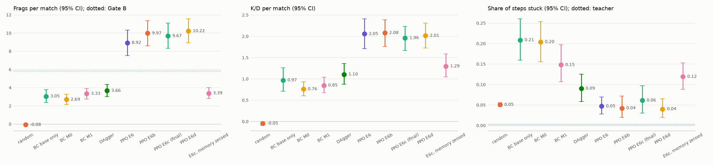

**Фраги, K/D и доля времени «застрял»** у каждого игрока на всех 88 матчах. Линия — учитель. Случайный игрок задаёт
нулевой уровень. «E6c, memory zeroed» — та же сеть, но память GRU обнуляется на каждом шаге.

## 2. Где модель сильна, а где ломается

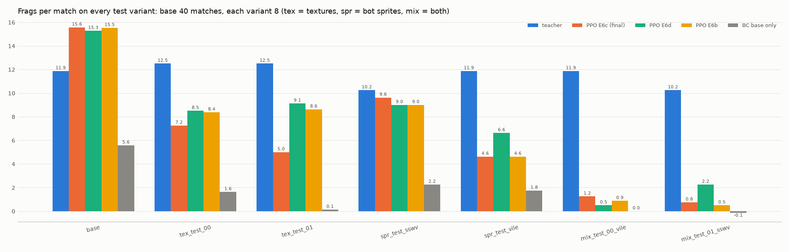

**Фраги на каждом test-варианте.** tex — чужие текстуры стен и пола, spr — чужие спрайты ботов (SS-солдат, архвайл),
mix — то и другое сразу. Учитель играет по разметке движка, а не по картинке, поэтому от графики не зависит. Студенты
держатся на текстурах и спрайтах по отдельности, но на mix-вариантах падают до 0.5–2.3 фрага: сеть не узнаёт врага в
незнакомом облике на незнакомом фоне.

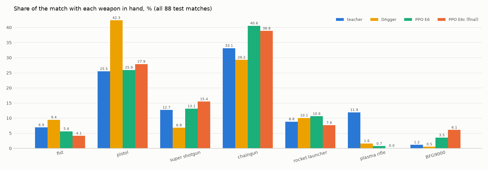

**Доля матча с каждым оружием в руках.** PPO научился брать сильное оружие чаще учителя: у E6c BFG9000 в руках 6 % матча,
у учителя 1.2 %.

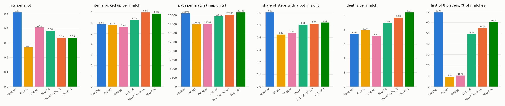

**Стиль игры:** попадания на выстрел, подобранные предметы, пройденный путь, доля шагов с ботом в поле зрения, смерти
за матч и доля матчей, где игрок первый из 8. PPO сделал модели агрессивнее: E6c попадает реже (0.33 попадания на
выстрел против 0.41 у DAgger и 0.51 у учителя), зато стреляет больше и первым из 8 становится в 55 % матчей (DAgger —
в 10 %, учитель — в 69 %). Цена — смерти: 4.88 за матч против 3.70 у учителя.

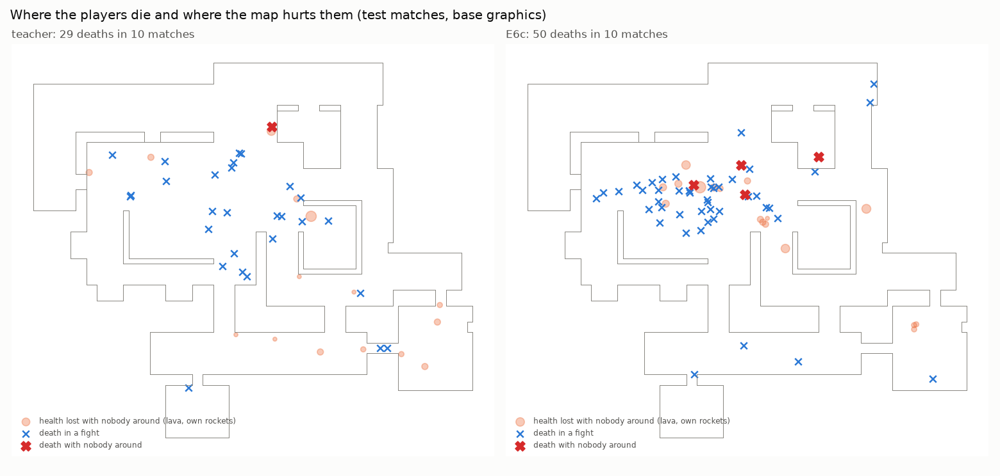

**Где умирают игроки и где их ранит сама карта** (10 тестовых матчей). Крестики — смерти: синие в бою, красные без
врага рядом. Оранжевые точки — потеря здоровья, когда ни бота, ни снаряда не видно (лава, свои ракеты). Скопление
смертей E6c в центре — это **яма с лавой вокруг BFG9000**: сектор LAVA1, 384×384, −20 HP примерно раз в секунду. BFG
стоит на пьедестале посередине, и без прохода по лаве его не взять. **На лаве случились 23 из 50 смертей E6c и 4 из 29
у учителя.** Это почти вся разница в смертях между ними. Скрипт: `scripts/dm/dm_death_map.py`.

## 3. Память

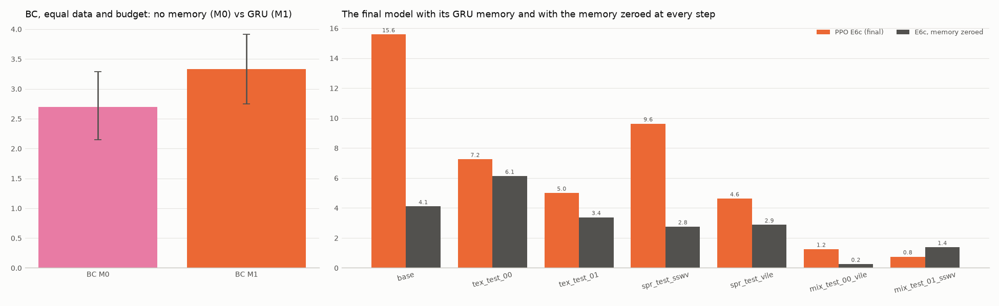

**Нужна ли память.** Слева BC-модели с одинаковыми данными и бюджетом: без памяти (M0) и с GRU (M1). У M1 на 0.64
фрага больше [+0.03, +1.20], разница значима. Справа итоговая модель с памятью и с памятью, обнулённой на каждом шаге:
без памяти она теряет 6.28 фрага за матч (на базе 15.6 → 4.1) и застревает вдвое чаще (12 % времени против 6 %). PPO
построил стратегию, которая держится на памяти.

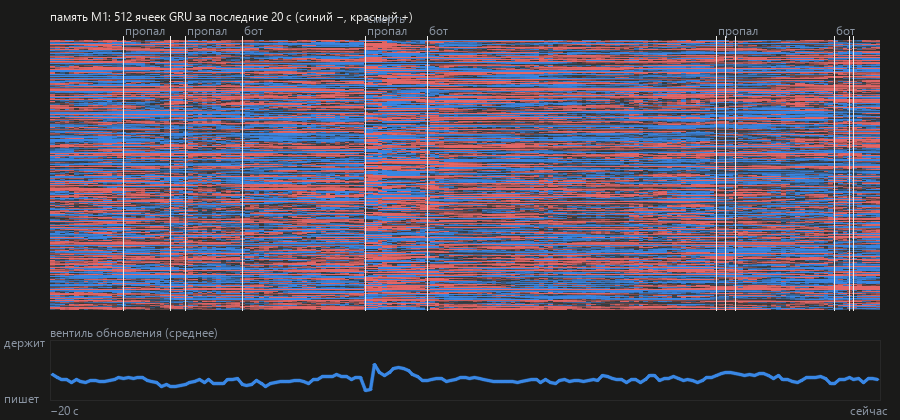

**Лента памяти E6c за последние 20 секунд.** Каждая строка — одна из 512 ячеек GRU (красный +, синий −), время идёт
слева направо. Вертикальные метки — события: «бот» (враг появился), «пропал» (враг исчез из вида), «смерть». После смерти
и при появлении врага рисунок ячеек резко меняется, а между событиями многие ячейки держат значение секундами. Нижняя
кривая — вентиль обновления: насколько сеть держит старое и насколько пишет новое.

## 4. Что внутри сети

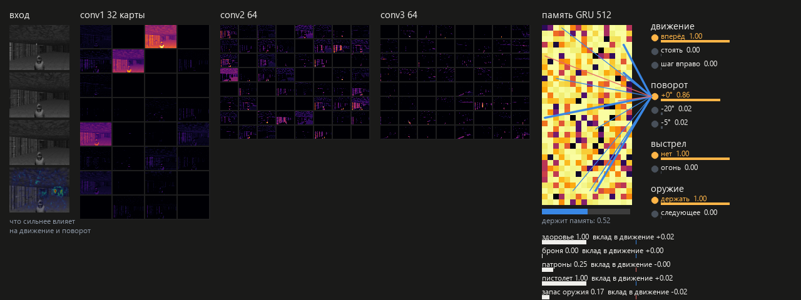

**Один шаг E6c изнутри.** Слева вход: 4 последних кадра и карта того, какие пиксели сильнее всего влияют на движение и
поворот. Дальше карты признаков трёх свёрточных слоёв (32, 64, 64), затем 512 ячеек памяти GRU. Линии ведут от самых
влиятельных ячеек к выбранным действиям. Справа четыре головы действий с вероятностями (движение, поворот, выстрел,
оружие), снизу вклад вектора состояния (здоровье, броня, патроны, оружие).

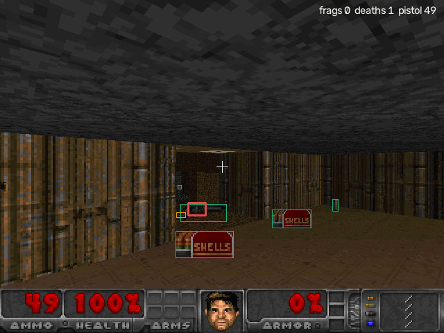

**Что видит игрок и что знает учитель.** Кадр 640×480 с рамками разметки движка: бот (красная), предметы (зелёные).
Учитель-читер видит эти рамки, но не видит ботов сквозь стены. Ученику достаётся только пиксельная картинка 160×120.

### Нейроны места

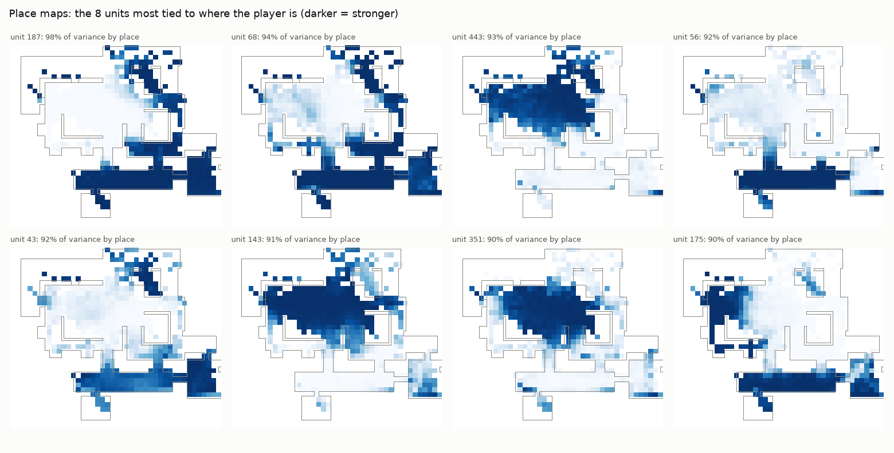

**8 ячеек памяти E6c, сильнее всего связанных с местом** (40 тестовых матчей). Тёмные клетки — там ячейка активна.
У лучших ячеек 90–98 % изменчивости объясняется положением игрока: сеть сама, без подсказок, завела внутреннюю карту
комнат («южный коридор», «центральный зал», «западное крыло»).

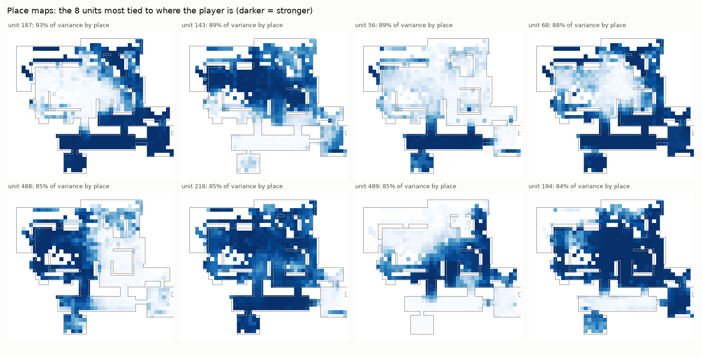

**То же для DAgger-модели**, с которой начинался PPO. Ячейка 187 — главный «нейрон места» у обеих моделей: PPO не
стёр карту, которую сеть выучила по примерам учителя, а уточнил её (93 % → 98 %).

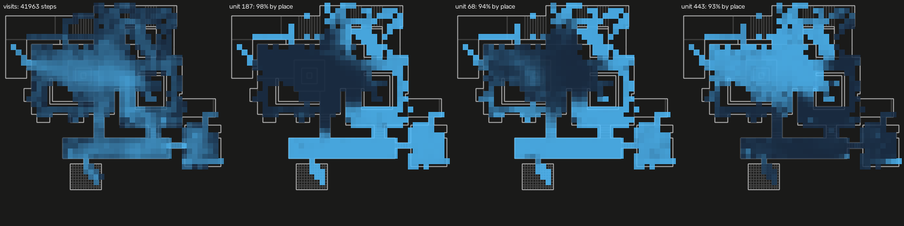

**Живая карта места**, как её рисует дашборд во время игры. Слева посещения E6c за 40 матчей, дальше три самые
«местные» ячейки, светлее — сильнее.

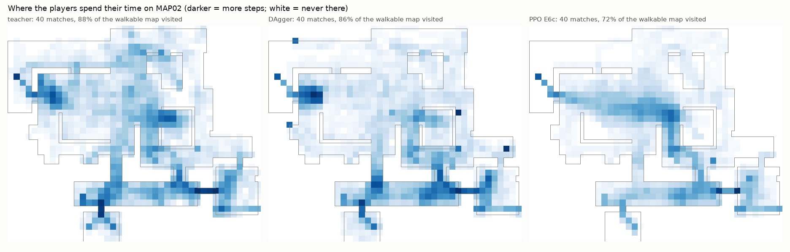

**Где игроки проводят время** (40 тестовых матчей, обычные точки появления). Учитель бывает на 88 % проходимой карты,
DAgger на 86 %, E6c на 72 %. PPO сузил маршрут до выгодной петли «центральный зал — восточный проход — южный коридор»,
а северо-западные комнаты посещает редко.

### Специализация ячеек

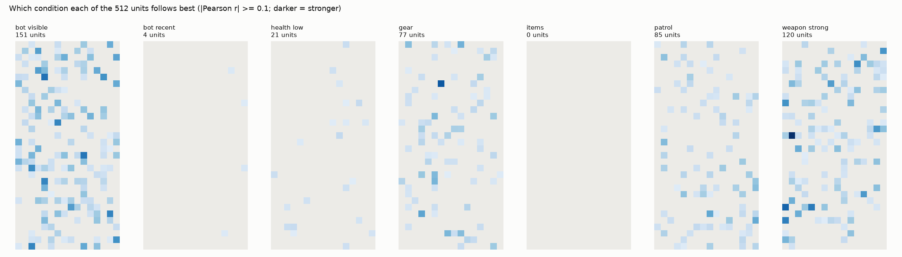

**За каким условием лучше всего следует каждая из 512 ячеек E6c** (|r| ≥ 0.1, темнее — сильнее): бот виден, бот был
недавно, мало здоровья, режим «снаряжение», режим «предметы», патруль, сильное оружие в руках.

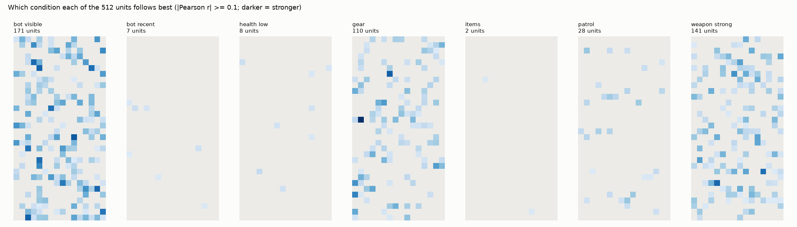

**То же для DAgger.** Самое заметное изменение после PPO — ячейки патруля: **28 → 85**. Это след наград за исследование
карты и штрафов за топтание на месте (E6b–E6c). Ячеек «снаряжения» стало меньше (110 → 77): сеть собирает оружие по
пути, а не отдельными походами.

| условие | DAgger | E6c |
|---|---|---|
| бот виден | 171 | 151 |
| бот был недавно | 7 | 4 |
| мало здоровья | 8 | 21 |
| снаряжение | 110 | 77 |
| предметы | 2 | 0 |
| патруль | 28 | 85 |
| сильное оружие | 141 | 120 |

### Состояния сети

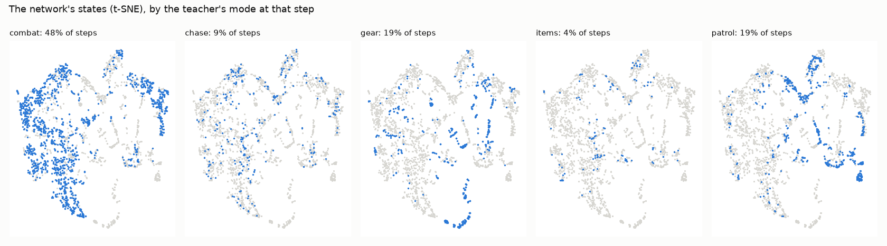

**Состояния памяти E6c на плоскости (t-SNE)**, раскрашенные по режиму, который в этот момент выбрал бы учитель. Бой
(48 % шагов) занимает отдельный большой материк. Патруль и снаряжение ложатся вытянутыми «тропами»: это маршруты по
карте, вдоль которых состояние памяти плавно меняется.

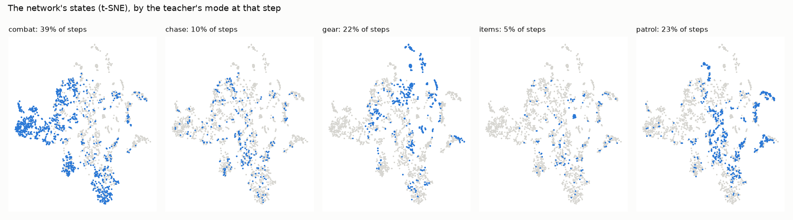

**То же для DAgger** — для сравнения, как меняется устройство памяти после PPO.

## 5. Видео

Все матчи двухминутные, 35 кадров/с, с рамками разметки, HUD и мини-картой. Seed — из test-набора.

| файл | что показано | итог матча |
|---|---|---|
| `e7_demo.mp4` (3 мин) | Один и тот же матч (seed 39003, по 60 с) у учителя, DAgger и E6c, с подписями. | учитель 6 фрагов / 2 смерти; DAgger 1 / 4; E6c 12 / 5 |
| `e7_brain_e6c.mp4` (60 с) | E6c изнутри в движении: кадры, свёрточные карты, память GRU, вероятности действий. | — |
| `e7_e6c_base.mp4` | E6c, базовая графика, seed 39003. | 19 фрагов, 7 смертей |
| `e7_teacher_base.mp4` | Учитель на том же матче. | 14 фрагов, 3 смерти |
| `e7_e6c_no_memory.mp4` | E6c с памятью, обнулённой на каждом шаге, тот же матч: та же сеть без памяти. | 2 фрага, 2 смерти |
| `e7_e6c_tex_test_00.mp4` | E6c на чужих текстурах (seed 39001). | 8 фрагов, 3 смерти |
| `e7_e6c_spr_test_sswv.mp4` | E6c против ботов в облике SS-солдат (seed 39002). | 13 фрагов, 6 смертей |
| `e7_e6c_mix_test_00_vile.mp4` | E6c: чужие текстуры + боты-архвайлы (seed 39000). Худший случай: сеть почти не узнаёт врагов. | −1 фраг, 4 смерти |
| `e7_teacher_mix_test_00_vile.mp4` | Учитель на том же матче: ему графика не мешает. | 8 фрагов, 7 смертей |

## Как пересобрать

```
python scripts/dm/run_hidden.py runs/dm/e7_media.cmd          # видео, снимки сети, нейроны (≈ 25 мин)
python scripts/dm/dm_e7_report.py                              # e7_test.md, e7_test.png, e7_ladder.png
python scripts/dm/dm_e7_figures.py                             # variants, memory, models, weapons, play
python scripts/dm/dm_death_map.py --who teacher runs/dm/e6/ppo_e6c_01001k.pt --names teacher E6c \
    --out reports/dm/e7_test/e7_deaths.png                     # смерти и лава
python scripts/dm/dm_coverage.py --teacher data/dm/r0 --matches 40 --models runs/dm/dagger_sp_r2.acts.npz \
    runs/dm/e6/ppo_e6c_01001k.acts.npz --names DAgger "PPO E6c" --out artifacts/dm/e7_test/e7_coverage.png
```
