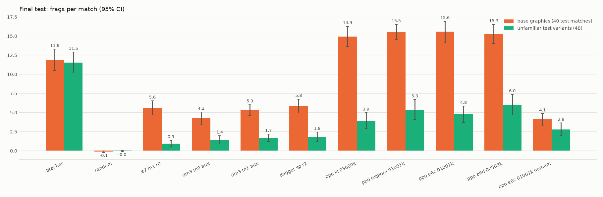

# E7: финальный test

40 матчей на базовой графике (TEST_SEEDS) и по 8 на каждом из 6 test-вариантов графики. Ни эти seed, ни эти варианты не использовались ни в обучении, ни при выборе моделей. Фраги за 2-минутный матч, 95 % bootstrap-интервал.

## Критерии спека

| критерий спека v2 §1 | значение | выполнен |
|---|---|---|
| база: лучшая модель ≥ 70 % фрагов учителя | 131 % (15.57 против 11.88) | да |
| незнакомая графика: ≥ 60 % учителя | 41 % (4.75 против 11.54) | нет |
| незнакомая графика: значимо больше ученика только на базовой графике | 3.81 [2.83, 4.77] | да |
| память: M1 − M0 (BC, равные данные и бюджет), половина интервала ≤ 15 % учителя | 0.64 [0.03, 1.20], половина 0.59 при пороге 1.75 | да |

## Все игроки

| игрок | база (40) | доля учителя | незнакомая графика (48) | доля учителя |
|---|---|---|---|---|
| учитель (`teacher`) | 11.88 [10.50, 13.28] | 100 % | 11.54 [10.29, 12.90] | 100 % |
| случайный игрок (`random`) | -0.12 [-0.25, -0.03] | -1 % | -0.04 [-0.12, 0.04] | -0 % |
| BC только на базовой графике (контроль) (`e7_m1_r0`) | 5.58 [4.67, 6.53] | 47 % | 0.94 [0.56, 1.35] | 8 % |
| BC M0 (без памяти) (`dm3_m0_aux`) | 4.22 [3.40, 5.08] | 36 % | 1.42 [0.90, 1.96] | 12 % |
| BC M1 (E4) (`dm3_m1_aux`) | 5.30 [4.58, 6.03] | 45 % | 1.69 [1.21, 2.17] | 15 % |
| DAgger (E5) (`dagger_sp_r2`) | 5.85 [4.95, 6.75] | 49 % | 1.83 [1.23, 2.44] | 16 % |
| PPO (E6) (`ppo_kl_03000k`) | 14.93 [13.62, 16.27] | 126 % | 3.92 [2.92, 4.96] | 34 % |
| PPO + движение (E6b) (`ppo_explore_01001k`) | 15.53 [14.55, 16.52] | 131 % | 5.33 [4.08, 6.69] | 46 % |
| PPO + случайные старты (E6c) (`ppo_e6c_01001k`) | 15.57 [14.12, 16.93] | 131 % | 4.75 [3.67, 5.83] | 41 % |
| PPO + демонстрации (E6d) (`ppo_e6d_00503k`) | 15.28 [14.03, 16.52] | 129 % | 6.00 [4.69, 7.35] | 52 % |
| E6c с обнулённой памятью (`ppo_e6c_01001k_nomem`) | 4.10 [3.35, 4.85] | 35 % | 2.79 [1.96, 3.62] | 24 % |

## Парные сравнения

| сравнение (все 88 матчей) | разность фрагов [95 % ДИ] |
|---|---|
| ppo_e6c_01001k − teacher | -2.02 [-3.66, -0.30] |
| ppo_e6c_01001k − dagger_sp_r2 | 6.01 [4.89, 7.24] |
| ppo_e6c_01001k − ppo_kl_03000k | 0.75 [-0.24, 1.69] |
| ppo_e6c_01001k − ppo_e6d_00503k | -0.55 [-1.65, 0.51] |
| ppo_e6c_01001k − ppo_e6c_01001k_nomem | 6.28 [4.92, 7.62] |
| dm3_m1_aux − dm3_m0_aux | 0.64 [0.03, 1.20] |

## По test-вариантам графики (фраги за матч, по 8 матчей)

| вариант | учитель | E6c (итоговая) | E6d 503k | E6b | BC только на базе |
|---|---|---|---|---|---|
| база (40 матчей) | 11.88 | 15.57 | 15.28 | 15.53 | 5.58 |
| tex_test_00 (текстуры) | 12.50 | 7.25 | 8.50 | 8.38 | 1.62 |
| tex_test_01 (текстуры) | 12.50 | 5.00 | 9.12 | 8.62 | 0.12 |
| spr_test_sswv (спрайты ботов) | 10.25 | 9.62 | 9.00 | 9.00 | 2.25 |
| spr_test_vile (спрайты ботов) | 11.88 | 4.62 | 6.62 | 4.62 | 1.75 |
| mix_test_00_vile (текстуры + спрайты) | 11.88 | 1.25 | 0.50 | 0.88 | 0.00 |
| mix_test_01_sswv (текстуры + спрайты) | 10.25 | 0.75 | 2.25 | 0.50 | −0.12 |

## Выводы

- **Базовая графика: ученик сильнее учителя-читера** — 15.57 против 11.88 фрага (131 %). Критерий спека (≥ 70 %)
  выполнен с большим запасом. Его выполняют все PPO-модели (126–131 %); имитация и DAgger дают 45–49 %.
- **Незнакомая графика: критерий ≥ 60 % учителя не выполнен** — итоговая E6c 41 %, лучшая из учеников E6d 52 %.
  Ученики почти полностью проваливаются на смешанных вариантах (новые текстуры и новый спрайт бота вместе): 0.5–2.3
  фрага против 10–12 у учителя. На вариантах только с новыми спрайтами или только с текстурами — 40–95 % учителя.
  На val-вариантах (на них шёл выбор моделей) E6c набирал 89 % учителя: test-варианты (VILE, SSWV, смешанные)
  оказались заметно труднее. Это главный честный минус работы.
- **Незнакомая графика против ученика только на базовой графике: значимо лучше** — +3.81 [+2.83, +4.77]: варианты
  графики в обучении работают, но до уровня учителя не доводят.
- **Память.** M1 − M0 при равных данных и бюджете (BC): **+0.64 [+0.03, +1.20]** — небольшой, но значимый плюс; точность
  ответа достаточна (половина интервала 0.59 при пороге 1.75). У обученной PPO-модели память решает гораздо больше:
  с памятью, обнуляемой на каждом шаге, E6c теряет **6.28 [4.92, 7.62]** фрага (9.67 → 3.39, на базе 15.57 → 4.10).
- **Итоговая модель против учителя на всех 88 матчах:** 9.67 против 11.69, −2.02 [−3.66, −0.30] — на базе выше, на
  незнакомой графике ниже. E6d 503k на test немного лучше E6c (10.22, разность +0.55 [−0.51, +1.65], в пределах шума)
  и лучше всех на незнакомой графике (52 %). Итоговой оставлена E6c, выбранная до test.
- **Выбор по свежим матчам слегка завышает:** E6c на свежих seed 13.20 (113 %), на test 9.67 (83 %) — разница в основном
  из-за более трудных test-вариантов графики; на базе test и свежие seed согласуются (15.6 против 15.6).
